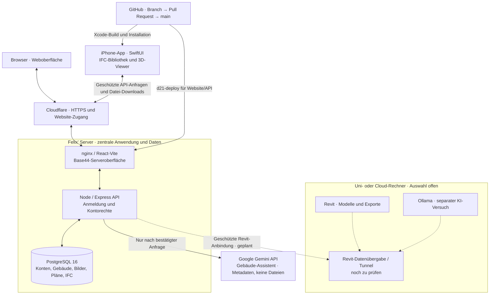

# KI TRIFFT GEBÄUDE
### D21 Digital Twin · GST-Teamprojekt 1 · Hochschule Darmstadt

### [🌐 D21-Dashboard öffnen](https://filling-vendor-verification-hop.trycloudflare.com)

### [🏛️ Vincents Projektseite öffnen](https://filling-vendor-verification-hop.trycloudflare.com/projekt/)

**Dashboard:** Gebäude, Dateien und Assistent · **Projektseite von Vincent:** Vorstellung, Vorgehen und Präsentation

Passwortgeschützter Projektzugang · Vorläufige Cloudflare-Testadresse; sie kann sich bei einem Tunnel-Neustart ändern.

**Gebäudedaten zusammenführen. IFC-Modelle ansehen. Revit anbinden. KI nachvollziehbar erproben.**

[Aufgaben](../../issues) · [Wochenplan](../../issues/13) · [Protokolle](docs/protokolle/README.md) · [Zusammenarbeit](CONTRIBUTING.md) · [🔒 Interne Projektdateien](https://github.com/felixdoering05-prog/D21-Projektdateien/releases/latest)

## Modelle und Baupläne für das Team

**[🔒 D21-Projektdateien herunterladen](https://github.com/felixdoering05-prog/D21-Projektdateien/releases/latest)** · [Privates Datei-Repository](https://github.com/felixdoering05-prog/D21-Projektdateien)

Seit dem **2. November 2026** liegen das bereitgestellte Revit-Modell, die IFC-Datei und sechs PDF-Baupläne als Download unter **Releases → Assets** im separaten privaten Repository. Die Prüfsummen-Datei `SHA256SUMS-Downloads.txt` ermöglicht den Abgleich der heruntergeladenen Originaldateien.

Mit dem eingeladenen GitHub-Konto anmelden und die Einladung zuerst annehmen. Ohne Zugriff kann GitHub eine 404-Seite anzeigen. Der Link hier erteilt keine Freigabe und macht die Dateien nicht öffentlich. Projektcode und gemeinsame Aufgaben bleiben in **diesem Hauptrepository**; interne Modelle und Pläne bleiben im privaten Dateibereich.

Die private Teamablage ist von der persönlichen Gebäudemappe der Website/iPhone-App getrennt: Ein GitHub-Upload stellt ein Modell noch nicht automatisch in der App bereit.

## Unser Ziel

Wir entwickeln einen digitalen Gebäudepass für das **D21**. Website und iPhone-App nutzen eine gemeinsame Datenablage für persönliche Konten, Gebäude, Bilder, Pläne und IFC-Modelle. Darauf aufbauend erproben wir die Anbindung von Revit und abgegrenzte KI-Anwendungen mit nachvollziehbaren Ergebnissen.

**Stand: 4. November 2026.** Umgesetzte Funktionen, vorbereitete Anbindungen und offene Arbeitspakete werden getrennt ausgewiesen. Ein funktionierender IFC-Viewer ist noch keine automatische Revit-Schnittstelle oder KI-Auswertung.

## Aktueller Entwicklungsstand

| Bereich | Bestätigter Stand |
| :--- | :--- |
| Website | Die aus Base44 übernommene Oberfläche liegt unter [`dashboard/base44-frontend/`](dashboard/base44-frontend/) und nutzt unsere API. Anmeldung, Gebäude und Dateien werden auf dem Projektserver verwaltet. Ein Gebäude-Assistent wurde am 3. November in das eigenständige Frontend portiert ([PR #67](../../pull/67)); dieser Weg ist laut PR noch nicht getestet und benötigt eine serverseitige Gemini-Konfiguration. Änderungen im Base44-Editor müssen weiterhin kontrolliert nach GitHub übernommen werden. |
| iPhone-App | Nativer SwiftUI-Prototyp unter [`ios/`](ios/): Projektstart mit Logo, persönliche Anmeldung, Profilbild und Begrüßung mit Account-Namen. |
| Gebäudemappe | Geführte Anlage über Name, Adresse, Fotos, Pläne und Übersicht; lokale Zwischenstände, wiederholbare Uploads, Suche, Vorschau, Umbenennen und Löschen. [Anleitung](docs/gebaeudemappe-ios.md) |
| Gemeinsame Daten | Website und iPhone verwenden dieselben persönlichen Konten, Gebäude und Dateien in PostgreSQL. Andere Konten erhalten keine automatische Gebäudefreigabe. |
| Bilder, PDF und DWG | Upload und Download pro Gebäude, Bild-/PDF-Vorschau; DWG-Dateien können in einer geeigneten CAD-App geöffnet werden. [Dateiablage](docs/dateien.md) |
| IFC-Modelle | Zentrale Ablage pro Gebäude auf dem Server; Upload auch über die Website. In der iPhone-App: 3D-Ansicht mit Drehen, Zoomen, Draufsicht und Bauteilauswahl. Die Modellberechnung läuft auf dem Gerät, nicht auf dem VPS. [IFC-Anleitung](docs/ifc-viewer-ios.md) |
| IFC-Bibliothek | Modellkarten mit Gebäude und Größe, Suche nach Datei-/Gebäudenamen, Ladeanzeigen, gezielte Wiederholungen und verständliche leere Ansichten. Vorhandene Ergebnisse bleiben bei Aktualisierungsfehlern sichtbar. [Stand und Screenshots](docs/protokolle/2026-10-28-ifc-modellbibliothek.md) |
| IFC-Interaktion / Smart Home | Bauteile im iOS-Viewer auswählen, einfärben und ausblenden; simuliertes Raumlicht für `IFCSPACE`-Räume mit Geometrie. **Nur visuelle Simulation**, keine reale KNX-/Lampensteuerung und keine physikalische Lichtberechnung. [Dokumentation](docs/ifc-viewer-ios.md) · [PR #42](../../pull/42) |
| Passwort vergessen | Technisch vorbereitet; echter Mailversand benötigt weiterhin ein eingerichtetes Projekt-Absenderkonto. [Einrichtung](docs/passwort-mail.md) |
| Revit-EG-Arbeitsstand | In Revit 2027.3 wurde lokal ein unvollständiges EG-Modell mit **50 nativen Wänden und 28 geschlossenen Räumen** erstellt; RVT und IFC4 wurden gespeichert und technisch geprüft. **11 Räume** liegen innerhalb des technischen Prüfwerts von 0,03 m², **17** haben noch Flächenabweichungen und **5 Planräume** fehlen. Türen, Fenster, Decken, Dach und weitere Geschosse sind noch offen. Keine fachliche Abnahme und keine Freigabe zum Hochladen. [Arbeitsnachweis](docs/revit-planrekonstruktion.md) · [PR #44](../../pull/44) |
| Revit-Rechner / Datenweg | Benjamins Gaming-PC entfällt. Ein Uni- oder Cloud-Rechner und dessen sichere Anbindung sind noch auszuwählen; eine automatische Revit-Übergabe ist nicht nachgewiesen. Die lokal erzeugten RVT/IFC-Dateien ersetzen keinen PC-Server-Integrationstest. [#9](../../issues/9), [#19](../../issues/19) |
| KI im Produkt | Der native Gebäude-Assistent nutzt Gemini über unsere API nach bestätigter Übertragung von Gebäudedaten und Dateimetadaten. Ein produktiver API-Test mit synthetischen Daten ist dokumentiert ([PR #59](../../pull/59)). IFC-Typzahlen, privater KI-Verlauf und bestätigte Ansichts-Befehle; keine automatische Plan-/Geometrieanalyse. Der Web-Assistent ist portiert, aber noch nicht Ende-zu-Ende geprüft ([PR #67](../../pull/67)). [Emirs Aufgabe #33](../../issues/33) |

Die Dateigrenzen betragen **20 MiB je IFC-Datei**, **25 MiB für andere unterstützte Dateien** und **250 MiB pro Konto**. Große echte Revit-Exporte und vollständige Abläufe auf den Geräten des Teams müssen zusätzlich geprüft werden.

Ausgewählte Meilensteine: [#39 · IFC-Modellbibliothek](../../pull/39), [#44 · lokaler Revit-EG-Arbeitsstand](../../pull/44), [#47 · Web-BIM-Viewer](../../pull/47), [#57 · Kontakte und Gebäudefreigaben](../../pull/57), [#58 · Gemini-Assistent](../../pull/58), [#60 · IFC-Modellbefehle](../../pull/60), [#61 · gemeinsame Modellansicht und KI-Chat](../../pull/61), [#66 · Vincents Projektseite](../../pull/66), [#67 · Web-Assistent portiert](../../pull/67) und [#68 · Teamvorstellung](../../pull/68). Die frühere Startaufgabe für den Xcode-Prototyp [#8](../../issues/8) ist geschlossen.

## Neuer Stand · 30. Oktober 2026: Web-BIM-Viewer

Mit [PR #47](../../pull/47) wurde ein IFC-BIM-Viewer für die **Website** in `main` übernommen. Er nutzt die zentrale, auch vom iPhone verwendete IFC-Modellbibliothek; BIM-Ansicht und Bauteilinteraktionen sind im Web-Frontend implementiert. [Technische Anleitung](docs/web-bim-viewer.md) · [Entwicklungsprotokoll](docs/protokolle/2026-10-30-web-bim-viewer.md).

**Prüfgrenze:** Der Merge bestätigt den implementierten Code, nicht einen erfolgreich absolvierten Ende-zu-Ende-Test auf dem Produktivserver oder mit einem vollständigen D21-Modell. Revit-Liveanbindung, Sensorik/KNX und reale Lichtsteuerung sind dadurch weiterhin nicht nachgewiesen. Für die Projektabnahme sind ein Test mit freigegebenem IFC-Modell, Web-/iPhone-Vergleich und nachvollziehbare Testergebnisse erforderlich.

## Gebäude-Assistent mit Gemini

Im Gebäude-Reiter **KI** unterstützt ein privater Chat mit Gemini und gespeichertem Verlauf. Das ausgewählte IFC wird auf dem Server nach Typen gezählt. Modellbefehle lassen sich nach Vorschau und Bestätigung gemeinsam speichern. **3D** öffnet das Modell direkt; Farben, Sichtbarkeit und simuliertes Licht werden mit der Website abgeglichen. Keine IFC-Dateien oder Teamnachrichten werden an Google übertragen. [Bedienung und Schnittstellen](docs/gemeinsames-modell-und-ki-chat.md). [Bedienung, Datenumfang und Limits](docs/gemini-gebaeudeassistent.md).

## Gemeinsam in der iPhone-App arbeiten

Kontakte über E-Mail mit Bestätigung, Gebäudeeinladungen, gemeinsame Dateien/IFC, In-App-Mitteilungen und ein Textchat pro Gebäude. Neue Navigation: **Gebäude · Kontakte · Mitteilungen**. [Bedienung und Schnittstellenvertrag](docs/zusammenarbeit-app.md). Noch keine Push-Mitteilungen oder gemeinsame Sensor-/KI-Datensätze.

## Automatisierungen mit n8n

Zwei nur lesende Abläufe protokollieren GitHub-Aufgaben/PR-Änderungen und die Erreichbarkeit der Website im n8n-Ausführungsverlauf. Der Verwaltungszugang bleibt privat über SSH; noch kein WhatsApp- oder Mailversand. [Zugang, Bedienung und Grenzen](dashboard/n8n/README.md) · [Protokoll](docs/protokolle/2026-11-02-n8n-automatisierungen.md)

## Neuer Stand · 3. November 2026: Website und KI

- **Projektseite:** Vincents eigenständige Präsentationsseite ist unter [\`/projekt/\`](https://filling-vendor-verification-hop.trycloudflare.com/projekt/) eingebunden ([PR #66](../../pull/66)). Sie zeigt inzwischen die sechs bestätigten Teammitglieder und ihre Rollen ([PR #68](../../pull/68)); Umsetzung, Ergebnisse und Fazit sind weiterhin offen. Der direkte Einstieg wurde mit [PR #69](../../pull/69) in der README ergänzt.
- **Web-Gebäudeassistent:** Ein Gebäude-Assistent wurde aus dem Base44-Export in das eigenständige Frontend portiert ([PR #67](../../pull/67)). Der Merge belegt den Code, **keinen erfolgreich getesteten Produktivablauf**; Gemini muss serverseitig eingerichtet sein.
- **Base44-Export:** Ein aktualisierter Export vom 3. November mit Gebäude-Assistent ist dokumentiert ([PR #65](../../pull/65)). Ein ZIP-Export ist keine automatische Synchronisierung mit dem laufenden Frontend.
- **Hochschul-KI:** Die h_da Open-WebUI-Anbindung wurde erprobt, die Aktivierung ist aber noch nicht als produktiv abgeschlossen bestätigt ([PR #64](../../pull/64), geschlossen und nicht gemergt). Gemini und h_da sind getrennte Anbieter; ein stiller Wechsel findet nicht statt.
- **Nachweise:** Technische Arbeitsprotokolle reichen bis zum 3. November. Ein freigegebenes Team-Sitzungsprotokoll ist weiterhin nicht verzeichnet ([Issue #46](../../issues/46)).

## Entwicklungsupdate · 3./4. November 2026

Die folgenden Funktionen wurden in `main` übernommen. **Code-Merge, bestandene automatisierte Tests und eine sichtbare Prüfung auf echten Geräten sind unterschiedliche Nachweisstufen.**

| Bereich | Implementierter Stand und Prüfgrenzen |
| :--- | :--- |
| Serververwaltung | Geschütztes Portal unter `/verwaltung` mit System-, Dienst- und Nutzungsübersicht; nur ausdrücklich freigeschaltete Administration. Backend-/Frontendtests bestanden. [PR #75](../../pull/75) · [Dokumentation](docs/serververwaltung.md) |
| Web-BIM-Viewer | Dreidimensionale Modellansicht mit Geschossauswahl, Freilegen/Trennen von Ebenen, Beschriftungen und überarbeiteter Navigation. Ein synthetischer Beispielcampus ist **kein** D21-Bestandsmodell. [PR #79](../../pull/79) |
| iPhone-Gerätebereich | Geführte Geräteanlage und Gebäude-/Raumzuordnung. Licht und Steckdosen sind **Simulationen**, Sensor- und spätere Home-Assistant-/MQTT-/Matter-Anbindungen nur vorgemerkt. Simulator-Builds bestanden; sichtbarer Gerätetest offen. [PR #77](../../pull/77) · [Anleitung](docs/geraete-ios.md) |
| iPhone-Dashboard und Messdaten | Dashboard, Sensorik, Energie, regelbasierte Analyse, lokale Demo sowie CSV-Messwertimport mit Vorschau. Gemini kann nach Aktivierung der kontoweiten KI-Einstellung begrenzte aggregierte Messwerte erhalten. Kein Nachweis einer angebundenen realen D21-Sensorik. [PR #81](../../pull/81) |
| Gebäudekarten und Sprache | Native Gebäudekarten und bestätigte Löschung eigener Chatnachrichten. Jetzt kontoweite KI-Aktivierung und ElevenLabs-Livegespräch mit Unterbrechen, Wellenanimation und bestätigten Geräte-Simulationsaktionen. Neutraler Anbieter-Gesprächstest erfolgreich; vollständiger iPhone-Test offen. [Live-Sprachassistent](docs/iphone-live-sprachassistent.md). [PR #82](../../pull/82) |
| Aufnahme-/Wiedergabesicherheit | Mikrofonfreigaben und verzögerte Sprachausgabe beim Ansichtswechsel/Hintergrundwechsel abgesichert; signierter iPhone-Build nachgewiesen. [PR #83](../../pull/83) |

Freigegebene echte Lampen und Simulationen können in der iPhone-App nachträglich **Gebäuden und IFC-Räumen** zugeordnet werden. RGB-fähige Lampen färben die zugeordneten Räume in der Modellansicht. Der mobile Viewer enthält Schatten und eine je Modell manuell platzierbare OSM-Umgebung in heller BIM-Optik. Private Lampen bleiben kontogeschützt; kein KI-Zugriff auf diese Geräte. [Bedienung, Daten und Grenzen](docs/geraete-raeume-rgb-karten.md).

**Priorität:** echte Messdaten und Gerätezugriffe nur nach Berechtigungsprüfung einbinden; Web-/iPhone-IFC-Ansichten und CSV-Import auf realen Geräten testen; Revit-Modell fachlich prüfen und eine nachvollziehbare Serverübergabe aufbauen. Der erste echte D21-Datenpunkt ist als [Zwischenziel #74](../../issues/74) bis 13. November erfasst. Der [Sprachassistent im IFC-Web-Viewer #80](../../issues/80) ist eine offene Aufgabe, kein fertig getestetes Feature. Fehlende freigegebene Team-Sitzungsprotokolle bleiben unter [#46](../../issues/46) offen. Technische Arbeitsprotokolle bis zum 3. November sind im [Protokollindex](docs/protokolle/README.md) verlinkt.

## Neue Rückmeldung: Claude-Zugänge und Campus-Heatmap

Herr Bürgy schlägt Claude mit einer Academic-/Team-Einladung vor und benötigt dafür **zwei Einladungs-E-Mail-Adressen**. Abrechnung und Zugangsmodell sind noch zu klären; ein konkreter Budgetbetrag und eingerichtete Zugänge sind nicht bestätigt.

Felix hat folgende Zuordnung festgelegt:

| Geplanter Zugang / Arbeitsbereich | Beteiligte | Schwerpunkt |
| :--- | :--- | :--- |
| **1 · Revit und KI** | **Josef & Lukas** | Revit-Prototyp, Modell-/IFC-Export und nachvollziehbare KI-Versuche |
| **2 · Schnittstellen und App** | **Benjamin & Felix** | PC-Server-Verbindung, Datenübergabe, API-Abstimmung und iOS-Weiterentwicklung |

Das ist die geplante Zuordnung der Arbeitsbereiche, keine Bestätigung bereits angelegter Konten. Felix stimmt die zwei konkreten Einladungsempfänger und E-Mail-Adressen direkt mit Herrn Bürgy ab. Persönliche Einladungsadressen gehören nicht in das öffentliche Repository.

Die Claude-Zugänge dienen zunächst der Projektarbeit. Sie ersetzen weder einen eingerichteten KI-Endpunkt in der App noch den geplanten Ollama-Test.

Zusätzlich nennt Herr Bürgy eine geplante **Campus-Heatmap**, aus der aktuelle und frühere Wärmeverhältnisse erkennbar werden sollen. Eine mögliche Verbindung mit unserem Projekt wird nach seiner angekündigten Abstimmung mit HSE, KNE und BuL geprüft. Datenquelle, Zugang, Schnittstelle und konkreter Projektumfang sind offen. Die **Baupläne des D21 bleiben vorrangig**; ihre Bereitstellung ist noch nicht bestätigt.

[Zuordnung, Status und nächste Schritte](docs/claude-zugaenge-und-campus-heatmap.md) · [Organisation #6](../../issues/6)

## Team und Verantwortlichkeiten

| Wer | Verantwortung | Nächste Arbeitspakete |
| :--- | :--- | :--- |
| **Felix** | Projektmanagement, Server und native iOS-App | Einladungsadressen, Pläne und Budget klären; App weiterentwickeln und auf Geräten prüfen · [#6](../../issues/6) |
| **Emir** | App-/Weboberfläche und Base44-Abgleich | Gemeinsame Datenablage erhalten, ersten echten ChatGPT-Ablauf umsetzen und Einrichtung/KI-Einsatz protokollieren · [#7](../../issues/7), [#21](../../issues/21), [#33](../../issues/33) |
| **Benjamin** | Schnittstellen und Systemverbindung | Sichere Uni-/Cloud-Anbindung, API-/Datenvertrag und Revit-Datenübergabe mit Felix und Emir abstimmen · [#9](../../issues/9), [#19](../../issues/19) |
| **Lukas & Josef** | Revit-Prototyp und KI-Versuche | Kleines Testmodell und geprüften Export erstellen; geplanten Claude-Arbeitsbereich für Revit/KI nutzen, sobald der Zugang eingerichtet ist · [#11](../../issues/11) |
| **Josef** | Ollama-Erprobung | Separaten Versuch auf geeigneter Hardware mit Prompts, Ergebnissen und Grenzen dokumentieren · [#12](../../issues/12) |
| **Vincent** | Dokumentation und Projektvorstellung | Projektwebsite, Gesamtstand und Teamvorstellung pflegen · [#10](../../issues/10), [#40](../../issues/40) |

Die neue Zugangszuordnung ändert diese fachlichen Rollen nicht. API- und Datenbankänderungen mit Felix beziehungsweise Benjamin abstimmen. [Ausführliche Rollenübersicht](docs/verantwortlichkeiten.md)

## Offene Prüfungen und nächste Schritte · Stand 3. November 2026

- **Felix:** zwei Einladungsempfänger mit Bürgy abstimmen; Bereitstellung und Nutzungsfreigabe der D21-Pläne nachhalten. Abrechnung und Budget bleiben offen, bis sie bestätigt sind.
- **Benjamin & Felix:** Uni-/Cloud-Rechner auswählen und sicheren Verbindungsweg planen und Revit-/IFC-Übergabe abstimmen. Der frühere Termin für [#19](../../issues/19) war der 28. Oktober; ein Abschlussnachweis steht noch aus.
- **Lukas & Josef:** den bereits dokumentierten lokalen EG-Modellstand aus [PR #44](../../pull/44) als Ausgangspunkt fachlich gegenprüfen; **17 Raumkonturen korrigieren und 5 fehlende Räume klären**, bevor weitere Geschosse oder Lichtsimulationen freigegeben werden. Eigene Beiträge beider Teammitglieder und die tatsächliche Übergabe separat nachweisen; die bisherigen technischen Prüfungen ersetzen keinen solchen Teamnachweis. [#11](../../issues/11)
- **Emir:** den aktualisierten Base44-Export und den portierten Web-Gebäudeassistenten mit dem tatsächlich laufenden Frontend abgleichen, Berechtigungen und Einwilligung Ende-zu-Ende testen; Umfang und Abschlussnachweis von [#33](../../issues/33) und [#21](../../issues/21) gesondert prüfen.
- **Vincent:** Teamvorstellung und Projektdokumentation aktualisieren; echte und geplante Funktionen unterscheiden.
- **Alle:** mindestens einen nachvollziehbaren Beitrag, Prüfergebnisse und offene Blocker im jeweiligen Issue festhalten.

Der [Wochenplan #13](../../issues/13) bündelt die Arbeit. Zusätzlich offen: dauerhafte Website-Adresse, Projekt-Mailkonto, bestätigter Stand von Emirs SSH-Zugang sowie automatische Datenbanksicherungen mit geprüftem Wiederherstellungsweg. Einzelne Sicherungen vor Deployments ersetzen noch kein automatisches Sicherungskonzept.

## Serverstruktur

Durchgezogen = vorhandener Datenweg · Gestrichelt = noch nicht bestätigte Anbindung. Website und App greifen über die API auf Daten zu, niemals direkt auf PostgreSQL. [Architektur und Grenzen](docs/architektur.md)

## So arbeiten wir auf GitHub

**Aufgabe → eigener Branch → Umsetzung und Prüfung → Pull Request → Review → Merge nach `main`.**

- GitHub ist die einzige Codequelle. Keine direkten Pushes auf `main` und keine Anwendungscode-Änderungen direkt auf dem Server.
- Fremde Änderungen erhalten; eigene Beiträge, Tests und Blocker nachvollziehbar dokumentieren.
- Website/API ausschließlich über `d21-deploy` veröffentlichen. Eine Änderung an der iOS-App wird über Xcode gebaut und installiert; dafür ist kein Server-Neubau nötig.
- Datenbank und bestehende Dateien erhalten. Niemals den Datenbank-Container oder `d21_dbdata` löschen; niemals `docker-compose down -v` verwenden.
- Keine Zugangsdaten, privaten Schlüssel oder nicht freigegebenen Baupläne veröffentlichen. Große Modelle gemäß [CONTRIBUTING.md](CONTRIBUTING.md) verwalten.

## Orientierung und Anleitungen

| Bereich | Einstieg |
| :--- | :--- |
| Website und Backend | [`dashboard/`](dashboard/), [Base44-Serveranbindung](docs/base44-serveranbindung.md) |
| iPhone-App / Xcode | [`ios/README.md`](ios/README.md) |
| Konten und Dateien | [Konten-API](docs/konten-api.md), [Dateiablage](docs/dateien.md), [Gebäudemappe](docs/gebaeudemappe-ios.md) |
| IFC / BIM | [IFC-Viewer, Modellbibliothek und Smart-Home-Simulation](docs/ifc-viewer-ios.md), [Revit-EG-Arbeitsstand](docs/revit-planrekonstruktion.md), [`revit/`](revit/README.md) |
| KI und geplante Claude-Zugänge | [Zugangsplanung und Heatmap](docs/claude-zugaenge-und-campus-heatmap.md), [`ki/`](ki/README.md) |
| Organisation | [Projektsteckbrief](docs/projektsteckbrief.md), [Aufgabenplan](docs/aufgabenplan.md), [Verantwortlichkeiten](docs/verantwortlichkeiten.md) |
| Nachweise | [Protokolle](docs/protokolle/README.md), [Leistungsnachweise](docs/leistungsnachweise.md), [`ergebnisse/`](ergebnisse/README.md) |
| Passwort-Mails | [Einrichtung und aktueller Vorbereitungsstand](docs/passwort-mail.md) |

Die Gesamtmeilensteine bleiben bestehen: [M1 · Umfang und Vorgaben](../../issues/1), [M2 · Revit und Pilot](../../issues/2), [M3 · Auswertung](../../issues/3), [M4 · Abgabe](../../issues/4). Hochschulvorgaben, Forschungsfrage und Bewertungsmaßstäbe müssen weiter konkretisiert werden.

*KI-Ausgaben gelten erst nach fachlicher Prüfung als Projektergebnis.*

## Präsentationsseite

**[Vincents D21-Projektseite öffnen →](https://filling-vendor-verification-hop.trycloudflare.com/projekt/)**

Die Landingpage liegt getrennt vom Dashboard unter **`/projekt/`**. Sie ist als Präsentationsentwurf mit Demo und offenen Ergebnissen gekennzeichnet; der Dashboard-Link führt zur App. Der bisherige Zugangsschutz gilt weiter. [Ablage und Bearbeitung](docs/landingpage-vincent.md).

## Serververwaltung

Felix kann mit seinem freigegebenen Projektkonto unter **`/verwaltung`** Serverkapazität, Dienste, API-/KI-Nutzung und registrierte Konten überwachen. Andere Konten erhalten keine Einsicht. Keine Schlüssel oder Passwörter im Portal. [Einrichtung und Grenzen](docs/serververwaltung.md).
