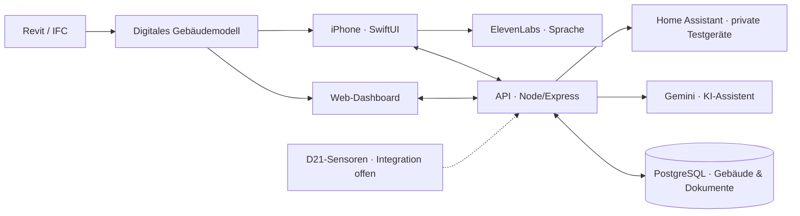

# 🏢 KI trifft Gebäude

### Digitaler Gebäudezwilling · BIM · Gebäudeautomation · Künstliche Intelligenz

**GST-Teamprojekt 1 · Hochschule Darmstadt · Gebäude D21**

*Gebäude verstehen, Daten verknüpfen und Technik intelligent bedienen – im Browser und auf dem iPhone.*

[**🌐 Dashboard**](https://filling-vendor-verification-hop.trycloudflare.com) · [**✨ Projektseite**](https://filling-vendor-verification-hop.trycloudflare.com/projekt/) · [**📋 Aufgaben**](../../issues) · [**📝 Änderungen**](CHANGELOG.md)

Die Dashboard-Adresse ist ein temporärer Cloudflare-Testzugang und kann sich ändern. Anmeldung erforderlich.

---

## 💡 Die Idee

Ein Gebäude besteht aus mehr als Plänen: Räume, Anlagen, Dokumente, Messwerte und Zuständigkeiten gehören zusammen. **KI trifft Gebäude** führt diese Informationen in einem digitalen Gebäudepass zusammen und verbindet sie mit einem interaktiven **IFC-/BIM-Modell**.

Am Beispiel des Hochschulgebäudes **D21** entwickeln wir einen Prototyp, der Gebäudeinformationen im Web und auf dem iPhone nutzbar macht. KI unterstützt bei der Suche und Bedienung; reale Sensordaten und die automatisierte Revit-Anbindung sind wichtige nächste Schritte.

## ✨ Funktionen im Überblick

| Bereich | Was der Prototyp bietet |
| :--- | :--- |
| 🏠 **Digitaler Gebäudepass** | Gebäude, Fotos, Dokumente und Pläne zentral verwalten; Zugriff über persönliche Konten und Freigaben |
| 🧊 **BIM & IFC** | 3D-Modelle ansehen, Geschosse und Bauteile auswählen, Ansichten verändern und Modellinformationen abfragen |
| 📱 **Web & iPhone** | React-/Vite-Dashboard und native SwiftUI-App mit gemeinsamer Server-Datenbasis |
| 🌡️ **Sensorik & Energie** | Dashboards, CSV-Import und Auswertungen; reale, simulierte und wetterbasierte Werte werden unterschieden |
| 💡 **Gebäudeautomation** | Erste private Home-Assistant-Lampenanbindung mit Zuordnung zu Gebäuden und IFC-Räumen |
| 🤖 **KI & Sprache** | Gebäudeassistent mit Google Gemini, IFC-Fakten als Kontext und bewusst gestartete Sprachfunktionen mit ElevenLabs |
| 👥 **Zusammenarbeit** | Gebäudefreigaben, Einladungen, gemeinsame Dokumente und Team-Chat |
| 🗺️ **Karten & Heatmaps** | Standortbezogene Ansichten, Kartenumgebung und klar gekennzeichnete Wetter-/Simulationsdaten |
| 📐 **Plan → IFC** | Unterstützte Erzeugung **prüfbarer Entwürfe** aus Plänen; keine automatische fachliche Freigabe |

> **Wichtig:** Dies ist ein Entwicklungsprototyp. Eine private Lampensteuerung ist **keine** Anbindung der D21-Gebäudeautomation. Wetter- und Simulationsdaten sind **keine** echten D21-Sensormesswerte. Ein erfolgreicher Build ersetzt keinen Praxistest.

## 🚀 Projektstand

**Dokumentationsstand: 14. November 2026.** Für den tagesaktuellen Code- und Freigabestatus gelten die [Pull Requests](../../pulls) und der [Changelog](CHANGELOG.md).

| Thema | Nachgewiesener Stand / Grenze |
| :--- | :--- |
| **iPhone-App** | Version **1.0.113** als Build dokumentiert; letzter ausdrücklich belegter TestFlight-Upload **1.0.112**. Externe Apple-Freigabe nicht bestätigt |
| **Web & IFC** | Gemeinsame Gebäudemappen, Viewer, Heatmaps und Modellanalyse werden weiterentwickelt; einzelne Funktionen benötigen noch Tests mit dem echten D21-Modell |
| **KI** | Geprüfte IFC-Fakten können in Text- und Sprachkontext einfließen; keine ungeprüfte Vollanalyse des Gebäudes behaupten |
| **D21-Messdaten** | Erster echter Datenpunkt mit Quelle, Einheit, Zeitstempel und Zugriffsfreigabe noch **nicht als abgeschlossen nachgewiesen** |
| **Revit-Anbindung** | Modell-/IFC-Arbeit vorhanden; reproduzierbarer automatischer Revit→Server-Prozess noch offen |

**Nächster Projekttermin:** 23. November 2026, 14:00 Uhr · Green Office, Gebäude C10.  
**Geplante Abgabe:** 5. Februar 2027.

### 🎯 Aktuelle Prioritäten

1. **P1 · [#74](../../issues/74)** – echten D21-Messwert mit Datenquelle, Einheit, Zeitstempel und Testnachweis integrieren (**Frist 13.11. überschritten; Abschluss gesondert prüfen**).
2. **P1 · [#102](../../issues/102)** – Sensoren, Thermostate, Schnittstellen und Datenrechte abstimmen.
3. **P1 · [#105](../../issues/105)** – Datenschutz und erforderliche Freigaben klären.
4. **P1 · [#101](../../issues/101)** – Hochschul-KI-Infrastruktur und Zugänge prüfen.
5. **P2 · [#73](../../issues/73)** – Revit-/IFC-Übergabe zum Server reproduzierbar dokumentieren.

[Alle Issues](../../issues) · [Offene Pull Requests](../../pulls) · [Aufgabenübersicht](docs/aufgabenplan.md)

## 🧩 So funktioniert das System

**Sicherheit und Datenhaltung:** Gebäudezugriffe werden serverseitig geprüft. API-Schlüssel gehören nicht ins Repository. Die ursprünglichen IFC-Dateien bleiben bei Ansichtsänderungen erhalten. KI- und Sprachdienste erhalten nur die jeweils vorgesehenen Daten und Berechtigungen.

[Technische Details](dashboard/README.md) · [iOS-App](ios/README.md) · [IFC-Viewer](docs/web-bim-viewer.md) · [Geräte & Räume](docs/geraete-raeume-rgb-karten.md)

## 👥 Unser Team

| Teammitglied | Schwerpunkt |
| :--- | :--- |
| **Felix** | Projektkoordination, Server, iPhone-App |
| **Emir** | Web-App, Oberfläche und Web-Assistent |
| **Benjamin** | Sensorik, Schnittstellen und Datenintegration |
| **Lukas** | Revit, IFC und Datenschutzthemen |
| **Josef** | Revit-Modellprüfung und KI-Infrastruktur |
| **Vincent** | Landingpage, Dokumentation und Präsentation |

[Ausführliche Verantwortlichkeiten](docs/verantwortlichkeiten.md) · [Zusammenarbeit](CONTRIBUTING.md)

## 📚 Dokumentation

| Thema | Weiterführende Informationen |
| :--- | :--- |
| 📌 **Aktuelle Änderungen** | [CHANGELOG.md](CHANGELOG.md) · [Pull Requests](../../pulls) |
| 🗓️ **Protokolle** | [Sitzungs- und Arbeitsprotokolle](docs/protokolle/README.md) |
| 🧊 **BIM / Revit** | [Revit](revit/README.md) · [IFC im Web](docs/web-bim-viewer.md) · [Modellprüfung](docs/revit-planrekonstruktion.md) |
| 📱 **App / Backend** | [iOS](ios/README.md) · [Dashboard](dashboard/README.md) · [Konten-API](docs/konten-api.md) |
| 🤖 **KI & Sprache** | [Gemini](docs/gemini-gebaeudeassistent.md) · [Live-Sprache](docs/iphone-live-sprachassistent.md) |
| 🧪 **TestFlight** | [Externe Beta – Stand und Grenzen](docs/testflight-externe-beta-100.md) |
| 🔎 **Marktforschung** | [Wettbewerbsvergleich](marktforschung/README.md) *(soweit bereits nach main übernommen)* |
| 💡 **Ideenradar** | [Neue Ansätze](docs/ideenradar/README.md) |
| 🗂️ **Projektorganisation** | [Projektsteckbrief](docs/projektsteckbrief.md) · [Aufgabenplan](docs/aufgabenplan.md) |

**Protokollstatus:** 03.11.2026 freigegeben; 10.11.2026 als Entwurf dokumentiert und noch gegenzuprüfen. Technische Arbeitsberichte sind keine freigegebenen Sitzungsprotokolle.

**Private D21-Dateien:** [Projektdateien und Releases](https://github.com/felixdoering05-prog/D21-Projektdateien/releases/latest) – nur für berechtigte Teammitglieder. Keine nicht freigegebenen Pläne im öffentlichen Repository ablegen.

---

**KI trifft Gebäude** · Hochschule Darmstadt · Gebäudesystemtechnik

*Ein Hochschulprojekt – entwickelt, getestet und Schritt für Schritt verbessert.*

