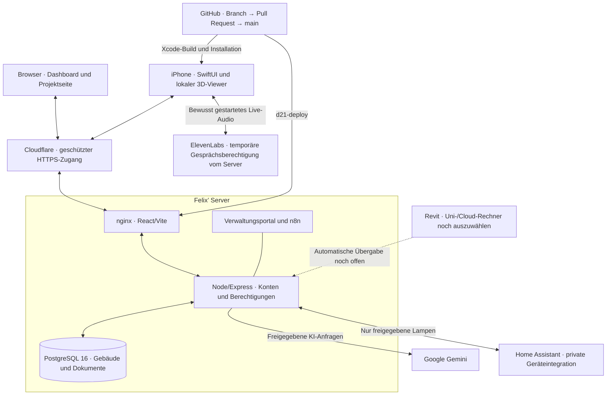

**iPhone 1.0.100 (100) – Vorbereitung externer TestFlight-Tests:** erste Testrunde ohne Live-Sprache/Sprach-SDK; Textassistent bleibt. An Server/Port gebundene Zugangsdaten, Datenschutzinformationen und passwortbestätigte Kontolöschung. [Prüfstand und offene Punkte](docs/testflight-externe-beta-100.md). Apples externe Freigabe ist gesondert erforderlich.

**Neu: Plan → IFC-Entwurf (10. November).** Einmalige Freigabe je Gebäude, automatische Analyse neuer Bilder/PDFs mit Google Gemini und separater BIMCraft-Verarbeitung. Vorläufige Entwürfe werden erst nach Prüfung als zusätzliche IFC übernommen. Bestehende Pläne manuell auswählen. [Bedienung, Grenzen und h_da-Umzug](docs/plan-zu-ifc.md). Entwicklung und Tests; Produktivprüfung siehe Arbeitsbericht.

**Neu: iPhone 1.0.98 – IFC automatisch auf der Karte platzieren.** Im Modell unter „Modell auf Karte“ werden Georeferenz und Nordrichtung erkannt. Ein Tipp übernimmt die Platzierung und lädt die 100-m-Kartenumgebung. Fehlt eine belastbare Referenz, einmal die Adresse eingeben; Drehung und Maßstab bleiben unter Details korrigierbar. Kartengrundrisse liefern nur einen Näherungsvorschlag. [Details](docs/automatische-ifc-platzierung.md).

# KI TRIFFT GEBÄUDE
### D21 Digital Twin · GST-Teamprojekt 1 · Hochschule Darmstadt

**Gebäude, Pläne, 3D-Modelle und verbundene Geräte an einem Ort – im Web und auf dem iPhone.**

### [Dashboard öffnen](https://filling-vendor-verification-hop.trycloudflare.com) · [Vincents Projektseite öffnen](https://filling-vendor-verification-hop.trycloudflare.com/projekt/)

Passwortgeschützter Projektzugang. Vorläufige Cloudflare-Testadresse; sie kann sich bei einem Tunnel-Neustart ändern. Zugangsdaten werden separat geteilt.

**Stand: 11. November 2026 · iPhone-App: Build 1.0.100 (100), externe Testversion ohne Live-Sprache; Upload bestätigt, Apple-Freigabe gesondert prüfen**

**Nächste Projektpräsentation · Montag, 23. November 2026, 14:00 Uhr · Green Office, Gebäude C10**

[Live-Countdown zur Präsentation öffnen](https://www.timeanddate.com/countdown/generic?iso=20261123T1400&p0=37&msg=KI+trifft+Geb%C3%A4ude)

Projektvorstellung: **6. November 2026** · Abschlusspräsentation/Abgabe: **5. Februar 2027**

[Neueste Änderungen](#neueste-änderungen) · [Vorführablauf](#vorführung-vom-6-november) · [Funktionen](#was-bereits-möglich-ist) · [Aufgaben](../../issues) · [Änderungsverlauf](CHANGELOG.md) · [Protokolle](docs/protokolle/README.md)

## Neuer App-Kandidat: geführter Gebäudeentwurf (12.11.2026)

Version 1.0.101 führt nach dem Plan-Upload direkt zur serverseitigen Generierung mit Gemini und BIMCraft. Fertige Entwürfe erscheinen als Mitteilung mit direktem Einstieg zur Prüfung. Echte Apple-Push-Nachrichten bei geschlossener App warten noch auf die Hochschulfreigabe. [Ablauf, Grenzen und Prüfstand](docs/protokolle/2026-11-12-gefuehrter-gebaeudeentwurf.md). Noch kein TestFlight-Upload dieser Version.

## Projektstand · 11. November 2026 (neueste Änderungen zuerst)

| Änderung | Tatsächlicher Stand / Prüfgrenze |
| :--- | :--- |
| **10.11. · [PR #119](../../pull/119)** | iPhone **1.0.100 (100)** für externe TestFlight-Prüfung vorbereitet: ohne Live-Sprach-SDK, mit Datenschutzhinweisen und passwortbestätigter Kontolöschung. 138 Backendtests und signiertes Archiv dokumentiert; Upload zu App Store Connect am 10.11., **Apple-Freigabe und Installation externer Tester nicht bestätigt**. |
| **10.11. · [PR #118](../../pull/118)** | D21-Web-IFC-Viewer mit Modellübersicht, Kamerasteuerung und verbesserter responsiver Bedienung. Campuszugriffsfehler werden zwischen fehlender Serverkonfiguration (503) und fehlender Kontoberechtigung (404) unterschieden; **keine automatische Zugriffsfreigabe**. |
| **10.11. · [PR #117](../../pull/117), [#116](../../pull/116)** | Vincents Landingpage mit Building-Sentinel-Logo und angepasster Farbpalette. |
| **10.11. · [PR #115](../../pull/115), [#112](../../pull/112)** | Teamprotokolle jetzt vorhanden: **03.11. freigegeben**, **10.11. Entwurf, Review offen**. [Protokollindex](docs/protokolle/README.md). |
| **10.11. · [PR #113](../../pull/113), [#114](../../pull/114)** | Einheitliche Glass-Optik und **getrennte** Heatmap-Modi: reale, frische, qualitätsgeprüfte Raummesswerte (nur bei korrekter IFC-Raumzuordnung), ausdrücklich simulierte Raumtemperaturen und historische DWD-Campusdaten. Das Feature belegt **noch keinen tatsächlich angebundenen D21-Sensor**. |
| **10.11. · [PR #108–#111](../../pull/108)** | Grundrissbilder/PDFs können zu **prüfbaren IFC-Entwürfen** verarbeitet werden. Kein automatisch fachlich freigegebenes Gebäudemodell; Fehlerbehandlung und Worker-Zugriff wurden nachgebessert. |

**Aktuelle P1-Nachweise:** Ein erster echter D21-Datenpunkt in der Web-App bleibt bis **13.11.2026** unter [#74](../../issues/74) offen. Sensorzugriff [#102](../../issues/102), Datenschutz [#105](../../issues/105), Hochschul-KI-Infrastruktur [#101](../../issues/101) und Review des Protokollentwurfs vom 10.11. sind weiterhin zu klären. Die ältere Aufgabenübersicht unten ist als historischer Stand vom 6./7. November zu lesen.

## Neue Arbeitspakete · 6./7. November 2026

Nach der Projektvorstellung wurden neue, **noch offene** Aufgaben für die nächste Phase angelegt. Diese organisatorischen Änderungen sind **keine** bereits abgeschlossenen technischen Integrationen.

| Priorität | Verantwortlich | Nächster belegbarer Schritt |
| :--- | :--- | :--- |
| **P1 · [#101](../../issues/101)** | **Josef** | Hochschulserver, KI-Professor und KI-PCs im D21 anfragen; Ressourcen, Zugang und Kosten dokumentieren. |
| **P1 · [#105](../../issues/105)** | **Lukas** | Datenschutz und Freigaben für Modelle, Sensorwerte, KI und Sprache klären; formale GitHub-Zuweisung ist noch blockiert. |
| **P1 · [#102](../../issues/102)** | **Benjamin** | Mit Herrn Jakob Sensoren/Thermostate, Schnittstellen, Datenrechte und ersten Datenpunkt klären. |
| **P1 · [#74](../../issues/74)** | **Benjamin + Emir** | Bis **13. November** einen **echten** D21-Messwert mit Quelle, Einheit und Zeitstempel in der Web-App nachweisen. |
| **Protokolle · [#99](../../issues/99)** | **Team** | Issue inzwischen geschlossen; Protokoll vom 03.11. freigegeben, Entwurf vom 10.11. noch gegenlesen und freigeben. |
| **P2 · [#103](../../issues/103)** | **Felix** | Mit anderer Revit-Gruppe einen freigegebenen Modell-/IFC-Pilot abstimmen. |
| **P2 · [#104](../../issues/104)** | **Felix** | Fortführung, Betrieb, Datenschutz und Übergabe nach Projektende klären. |
| **P2 · [#80](../../issues/80), [#73](../../issues/73)** | **Felix / Revit-Team** | Web-Sprachassistent und dokumentierten Revit-IFC-Serverprozess weiterführen. |

[Zentrale Aufgabenübersicht #106](../../issues/106). Benjamins Gaming-PC ist keine verfügbare Projektinfrastruktur; der bestehende Projektserver läuft, eine Hochschul-Anbindung ist noch offen. **Protokollstatus am 11.11.:** Der Termin vom 03.11. ist im Index als freigegeben geführt; das Protokoll vom 10.11. ist noch im Review. Technische Arbeitsberichte sind davon zu unterscheiden.

## Neueste Änderungen

**Das Neueste steht oben.** Die vollständige Entwicklung mit verlinkten Pull Requests steht im [Änderungsverlauf](CHANGELOG.md). Ältere Protokolle beschreiben den damaligen Stand.

| Stand | Änderung |
| :--- | :--- |
| **05.11. · #98 · iPhone 1.0.98** | Automatische IFC-Georeferenzierung und Kartenplatzierung mit prüfbaren Vorschlägen; manuelle Korrektur bleibt möglich. 124 Backend-, 18 Web-/Wetter- und 7 native Viewer-Tests sowie signierter Build erfolgreich. Physisches iPhone noch nicht getestet. [PR #98](../../pull/98) |
| **05.11. · #97 · iPhone-Heatmap** | Gebäudebezogene Wetteransicht mit bewusstem Open-Meteo-Abruf und illustrativer IFC-Einfärbung. Wettermodelle sind keine gemessenen D21-Raumtemperaturen. [PR #97](../../pull/97) |
| **05.11. · #96/#95** | Optionale weltweite IFC-Kartenposition im Web; beim Geschoss-Trennen wird nur die gewählte Etage abgesetzt. Für diese PRs wurden keine Tests/Builds ausgeführt. [#96](../../pull/96) · [#95](../../pull/95) |
| **05.11. · #94/#93** | Helles Glass-Design für Dashboard und BIM-Bedienfelder; Browser-/Liveprüfung nicht vollständig bestätigt. [#94](../../pull/94) · [#93](../../pull/93) |
| **05.11. · #92 · Campus-Heatmap** | D21-/Campusansicht mit historischen DWD-Lufttemperaturen aus Frankfurt/Main (2025); simulierte Oberflächentemperaturen klar getrennt. [PR #92](../../pull/92) |
| **05.11. · neu · iPhone-Heatmap** | Eigener Heatmap-Reiter für jedes zugängliche Gebäude mit Standort, Open-Meteo-Wetterdaten und KI-Kontext. Weiße 3D-Karte mit etwa 100 × 100 m Umgebung und IFC-/Grundriss-Plausibilitätsprüfung. [Bedienung und Grenzen](docs/iphone-heatmap-wetter.md) |
| **04.11. · #90** | Lampenassistent versteht kurze Raumnamen auch bei IFC-Bezeichnungen wie „EG-08 · Wintergarten“. ElevenLabs-Werkzeugparameter ergänzt und vom Anbieter angenommen. [PR #90](../../pull/90) |
| **04.11. · App 1.0.89 · #89** | Echte Daten als Standard; Vorstellungsmodus nur im Profil. Echte BIM-Vorschauen auf Gebäudekarten, Geräte innerhalb der Gebäude, Kontakte und Mitteilungen gemeinsam unter **Team**. KI-Chat und Live-Sprache können nach einmaliger Kontofreigabe zugeordnete private Lampen steuern. [PR #89](../../pull/89) |
| **04.11. · #88–#85** | Web-Viewer-Zugriffsfehler behoben; Gebäude-/IFC-Raumzuordnung, RGB, Schatten und manuell wählbare OSM-Umgebung ergänzt. Echte Home-Assistant-Lampen und unterbrechbare Live-Gespräche angebunden. [Details](CHANGELOG.md#4-november-2026) |

**Früherer Prüfstand (vor PR #98):** 117 Backend-Tests und fünf native Viewer-Tests erfolgreich; Web-Build und signierter iPhone-Build erfolgreich. Der signierte Build 1.0.96 ist erstellt; der zuvor bestätigte installierte Stand war 1.0.89. Serverstand nach PR #90 und private Lampenzuordnung wurden geprüft. Die automatisierten Schaltprüfungen verwenden Testlampen; die vollständige Sprachbedienung mit echter Hardware ist vor der Vorführung noch gemeinsam auszuprobieren. Technische Tests ersetzen keine fachliche Modellabnahme.

**Präsentations-Check (06.11.):** Die neue Kartenplatzierung ist als signierter Build vorhanden, aber nicht als auf dem physischen iPhone installiert bestätigt. Die Heatmaps verwenden Wetterdaten bzw. Simulationen, **keine nachgewiesene D21-Sensorik**. Für die Vorführung bitte tatsächlichen Geräte- und Website-Stand prüfen. Der Protokollindex enthält inzwischen einen freigegebenen Termin vom 03.11. und einen noch nicht freigegebenen Entwurf vom 10.11.; [#99](../../issues/99) ist geschlossen.

## Unser Projekt

Wir entwickeln am Beispiel des **D21** einen digitalen Gebäudepass. Gebäudeinformationen, Fotos, Pläne und IFC-Modelle werden zentral abgelegt und über Website und iPhone-App zugänglich. Darauf bauen Zusammenarbeit, Messwertdarstellung, ein Gebäudeassistent und erste echte Gerätesteuerung auf.

Der aktuelle Stand ist ein **Projektprototyp**. Eine private Home-Assistant-Lampe ist kein Nachweis für eine angeschlossene D21-Gebäudeautomation. IFC-Anzeige und Metadatenabfragen sind keine automatische Planprüfung oder vollständige Revit-Liveanbindung.

## Vorführung vom 6. November

Vorschlag für einen verständlichen Ablauf von etwa acht bis zehn Minuten:

| Schritt | Zeigen | Kernaussage |
| :--- | :--- | :--- |
| **1 · Projekt** | Vincents Projektseite und diese Übersicht | Problem, Ziel und Aufgabenverteilung erklären. |
| **2 · Persönlicher Gebäudepass** | iPhone öffnen, Konto und Gebäudekarten zeigen | Eigene Daten statt automatisch eingeblendeter Beispieldaten; BIM-Vorschau aus dem hinterlegten Modell. |
| **3 · Dokumente und 3D** | Ein vorbereitetes Gebäude mit freigegebenem IFC öffnen | Fotos/Pläne verwalten; Modell drehen, Bauteile auswählen, Farben und Sichtbarkeit ändern. |
| **4 · Gemeinsam arbeiten** | Team, Gebäudefreigabe und Gebäudechat zeigen | Kontakte brauchen Bestätigung; Gebäude werden ausdrücklich geteilt. Eigene Nachrichten lassen sich löschen. |
| **5 · Verbundene Lampen** | Geräte im Gebäude und einen zugeordneten IFC-Raum öffnen | Echte Lampen schalten, dimmen und färben; Raumfarbe zeigt den bestätigten Zustand vereinfacht an. |
| **6 · Gebäudeassistent** | Privaten KI-Chat und bewusst gestartetes Live-Gespräch öffnen | Zum Beispiel „Schalte die Lampen im Wintergarten blau“. Nur im freigegebenen privaten Gebäude und nach vorherigem Hardwaretest vorführen. |
| **7 · Ausblick** | Offene Punkte und nächste Meilensteine zeigen | Revit-Übergabe, reale D21-Messdaten und fachliche Prüfung bleiben Arbeitspakete. |

**Vorher prüfen:** iPhone geladen und aktuelle Version installiert; aktuelle Projektadresse und persönliche Anmeldung funktionieren; freigegebenes IFC bereits hochgeladen; Mikrofon und Lampen erreichbar; Raumzuordnung korrekt. Die reale Lampenvorführung ist eine private Integration, keine D21-Installation. Bei fehlender Hardwareverbindung den Stand ehrlich erklären. Für die reine Messwertvorstellung kann unter **Profil → Darstellung → Vorstellungsmodus** eine deutlich gekennzeichnete lokale Demo aktiviert werden; sie schaltet keine Hardware und stellt keine KI-Anfragen.

## Was bereits möglich ist

| Bereich | Aktueller Funktionsumfang |
| :--- | :--- |
| **Website** | React-/Vite-Oberfläche aus dem Base44-Export auf unserem Server; persönliche Konten, Gebäude und Dokumente über unsere API. BIM-Viewer und Gebäudeassistent sind im Repository integriert. Vincents Präsentationsseite liegt separat unter `/projekt/`. Änderungen im Base44-Editor werden nicht automatisch veröffentlicht. |
| **Native iPhone-App** | SwiftUI-App mit Projektstartbildschirm, Anmeldung, Profilbild und persönlicher Begrüßung. Hauptbereiche **Dashboard · Gebäude · Team**; Geräte werden im jeweiligen Gebäude geöffnet. |
| **Geführte Gebäudeanlage** | Name, optionale Adresse, Fotos, Pläne und Übersicht in einzelnen Schritten; lokaler Zwischenstand kann fortgesetzt werden. Dateisuche, Vorschau, Umbenennen und bestätigtes Löschen. |
| **Gemeinsame Datenbasis** | Web und iPhone verwenden dieselben Konten, Gebäudemappen und Dokumente in PostgreSQL. Zugriff nur auf eigene oder ausdrücklich freigegebene Gebäude. |
| **Bilder, PDF, DWG und IFC** | Upload/Download pro Gebäude; Bild-/PDF-Vorschau, DWG-Weitergabe an eine geeignete CAD-App und interaktive IFC-Anzeige. **Keine native DWG-Bearbeitung.** |
| **BIM und Modellzustand** | Drehen, Zoomen, Bauteilauswahl, Einfärben, Ausblenden und Zurücksetzen. Gespeicherte Ansichtsänderungen werden über den Server mit Web/iPhone abgeglichen; die IFC-Originaldatei bleibt unverändert. Der Web-Viewer bietet außerdem Geschossansichten. |
| **BIM-Gebäudekarten** | Vorschau des tatsächlich hinterlegten IFC-Modells: dunkelblau im hellen, hellblau im dunklen Erscheinungsbild. Ohne Modell erscheint ein Leerzustand. |
| **Räume, Licht und Umgebung** | Lampen Gebäuden und vorhandenen IFC-Räumen zuordnen; RGB/Helligkeit bei geeigneten Geräten. Vereinfachte Raumfarbmarkierung und Schatten im mobilen Viewer. Standort, Ausrichtung und Maßstab je Modell manuell wählen; OSM-Straßen und Nachbargebäude in BIM-Optik ausdrücklich laden. Keine automatische Vermessung oder physikalische Lichtberechnung. |
| **Echte Geräte** | Erste private Home-Assistant-Anbindung für ausdrücklich serverseitig freigegebene Lampen; private Demonstration mit Schreibtisch und drei Wintergarten-Deckenleuchten. Gebäude teilen erteilt anderen Personen keinen privaten Hardwarezugriff. Andere Integrationen sind noch keine fertigen Anbindungen. |
| **Team und Chat** | Kontaktanfragen per E-Mail-Adresse, bestätigte Gebäudeeinladungen, gemeinsame Dateien, In-App-Mitteilungen und Textchat pro Gebäude. Eigene Nachrichten nach Bestätigung löschen. **Noch keine iOS-Push-Mitteilungen.** |
| **Dashboard und Messdaten** | Sensorik, Energie, regelbasierte Auswertung sowie CSV-Import mit Vorschau und Prüfung. Ohne importierte Daten werden keine Messwerte erfunden. Fiktive Daten nur im ausdrücklich geöffneten Vorstellungsmodus. |
| **Gemini-Gebäudeassistent** | Privater Gebäudechat mit gespeichertem Verlauf, begrenzten Metadaten, optionalen IFC-Typzahlen und ausgewählten Messwertaggregaten. Modellbefehle als geprüfte, bestätigbare Vorschläge. Explizite Lampenaufträge für freigegebene Geräte und Räume. **Kein eigenes Modelltraining und keine automatische Analyse kompletter Pläne oder IFC-Geometrie.** |
| **Gebäudebezogene Heatmap** | Eigener iPhone-Reiter mit Standortwahl, Wettermodell/Prognose von Open-Meteo, Stundenregler und IFC-Einfärbung. KI-Chat und Sprache erhalten bewusst geladene Wetterwerte mit Quelle/Abrufzeit. Weiße Umgebung und etwa 100 × 100 m Kartenausschnitt. [Anleitung](docs/iphone-heatmap-wetter.md) |
| **Live-Sprachassistent** | ElevenLabs-Livegespräch mit direkter Sprachantwort, Unterbrechen und Wellenanimation. Bewusster Gesprächsstart und einmalige Kontofreigabe; keine zusätzlichen Bestätigungsboxen für jeden autorisierten Lampenauftrag. Schaltmeldungen beruhen auf der Home-Assistant-Rückprüfung. |
| **Serververwaltung** | Geschütztes Portal unter `/verwaltung` für freigeschaltete Administration: Kapazitäten, Dienste, API-/KI-Nutzung und registrierte Konten. Andere Konten erhalten keine Einsicht. Anbieterlimits werden nicht automatisch aufgehoben. |
| **Automatisierung** | Zwei lesende n8n-Abläufe protokollieren GitHub-Änderungen und Website-Erreichbarkeit im privaten Ausführungsverlauf. Noch kein automatischer WhatsApp-/Mailversand. |

**Dateigrenzen:** 20 MiB je IFC-Datei, 25 MiB für andere unterstützte Dateien und 250 MiB pro Konto. Große Revit-Exporte und vollständige Abläufe müssen auf den jeweiligen Geräten erprobt werden.

## Architektur und Datenwege

Website und App greifen über die API zu, niemals direkt auf PostgreSQL. IFC-Dateien liegen zentral auf dem Server; die Geometrie wird im Browser beziehungsweise auf dem iPhone berechnet. **Durchgezogen:** vorhandener Datenweg. **Gestrichelt:** noch offene Revit-Anbindung. Die native App und der Server werden getrennt aktualisiert.

API-Schlüssel bleiben auf dem Server. Kontoweite KI-Freigaben werden dort gespeichert; alte KI-Freigaben erhalten nicht automatisch Hardwarezugriff. Nur zugeordnete, ausdrücklich erlaubte Lampen können gesteuert werden. Ungültige oder wiederholte Aufträge werden geprüft, unbestätigte Zustände nicht als Erfolg ausgegeben. Audio und begrenzte KI-Kontexte werden bei bewusst gestarteter Nutzung an die jeweiligen Anbieter übertragen; keine automatischen vollständigen Plan-/IFC-Dateien oder Teamchats. [Aktuelle Freigaben und Grenzen](docs/app-echte-daten-lampenassistent.md)

## Modelle und Baupläne

**[Private D21-Projektdateien herunterladen](https://github.com/felixdoering05-prog/D21-Projektdateien/releases/latest)** · [Privates Datei-Repository](https://github.com/felixdoering05-prog/D21-Projektdateien)

Das bereitgestellte Revit-Modell, die IFC-Datei und sechs PDF-Baupläne liegen seit 2. November im privaten Repository unter **Releases → Assets**. Originaldownloads lassen sich mit `SHA256SUMS-Downloads.txt` prüfen. Einladung annehmen und mit dem eingeladenen GitHub-Konto anmelden; ohne Zugriff kann GitHub 404 anzeigen. Der Link erteilt keine Freigabe.

**Private Teamablage und Gebäudemappe sind getrennt:** Ein GitHub-Upload importiert ein Modell nicht automatisch in die App. Nicht freigegebene Pläne und interne Projektdateien werden nicht in dieses öffentliche Code-Repository übernommen.

## Team

| Person | Verantwortung |
| :--- | :--- |
| **Felix** | Projektmanagement, Serverbetrieb und native iPhone-App |
| **Emir** | App-/Weboberfläche, Base44-Abgleich und Web-Assistent |
| **Benjamin** | Schnittstellen, API-/Datenvertrag und Komponentenverbindung |
| **Lukas & Josef** | Revit-Prototyp, Modellprüfung, IFC-Export und dokumentierte KI-Versuche |
| **Josef** | Zusätzlich separater Ollama-Versuch auf geeigneter Hardware; nicht produktive App-KI |
| **Vincent** | Projektseite, Dokumentation und Präsentation |

[Verantwortlichkeiten](docs/verantwortlichkeiten.md) · [Wochenplan #13](../../issues/13) · [Zusammenarbeit](CONTRIBUTING.md)

## Offene Punkte und nächste Schritte

- **Bis Freitag:** gemeinsamen Vorführablauf auf den echten Geräten testen; Modell und Lichtzuordnung prüfen; Live-Sprache ausprobieren; nachvollziehbare Ergebnisse und Grenzen zeigen.
- **D21-Modell:** bereitgestelltes Modell und lokale Rekonstruktion unterscheiden. Der dokumentierte lokale EG-Arbeitsstand enthält 50 Wände und 28 Räume, aber noch 17 Flächenabweichungen und fünf fehlende Planräume. Fachlich prüfen, bevor er als vollständiges Bestandsmodell vorgestellt wird. [Arbeitsnachweis](docs/revit-planrekonstruktion.md)
- **Revit-Verbindung:** Uni-/Cloud-Rechner auswählen und sichere, reproduzierbare Übergabe aufbauen. Benjamins Gaming-PC steht nicht zur Verfügung. Eine Revit-Liveverbindung ist noch nicht nachgewiesen.
- **Reale D21-Daten:** erster überprüfbarer Messdatenpunkt und dokumentierter Datenvertrag; private Lampen und CSV-Import ersetzen keine angeschlossene D21-Sensorik. [Zwischenziel #74](../../issues/74)
- **KI-Zugänge:** Gemini ist angebunden. h_da Open-WebUI benötigt einen dauerhaften freigegebenen Netzweg; nicht als produktive Anbindung darstellen. Hochschule-Tools/AI-Führerschein und mögliche Claude-Zugänge mit Bürgy abstimmen; keine bestätigten Einladungen oder Budgets erfinden. Ollama bleibt ein separater Versuch.
- **Betrieb:** dauerhafte Domain, Projekt-Mailkonto für echte Passwort-Mails, automatisierte Backups mit geprüftem Wiederherstellungsweg und langfristige iOS-Verteilung offen. Aktuell kein TestFlight-Vertrieb.
- **Nachweise:** Teambeiträge, Testergebnisse und tatsächliche Sitzungsbeschlüsse dokumentieren. Entwicklungsberichte sind keine freigegebenen Team-Sitzungsprotokolle. [Protokolle](docs/protokolle/README.md)
- **Ausblick:** mögliche Campus-Heatmap mit der Hochschule klären; Datenquelle, Zugang und Umfang sind offen.

Die Meilensteine bleiben [M1 · Umfang](../../issues/1), [M2 · Revit/Pilot](../../issues/2), [M3 · Auswertung](../../issues/3) und [M4 · Abgabe](../../issues/4). **Abschluss: 05.02.2027.** Offene Aufgaben werden in Issues und der GitHub-Roadmap gepflegt.

## Entwicklung und Veröffentlichung

**Aufgabe → eigener Branch → Umsetzung und Prüfung → Pull Request → Review → Merge nach `main`.**

GitHub ist die einzige Codequelle. Keine direkten Pushes auf `main`, keine Anwendungscode-Änderungen auf dem Server. API- und Datenbankänderungen mit Felix beziehungsweise Benjamin abstimmen und fremde Änderungen erhalten.

- **Website/API:** aktiver Serverpfad `/opt/gst/dashboard`, Veröffentlichung ausschließlich mit `d21-deploy`. `/opt/d21` ist veraltet. Port 8088 bleibt an `127.0.0.1` gebunden; öffentlicher Zugriff erfolgt über den separaten Cloudflare-Tunnel.
- **iPhone:** über Xcode bauen und installieren. Ein GitHub-Merge oder Server-Deployment aktualisiert keine bereits installierte native App.
- **Daten erhalten:** Compose-Projekt `d21`, Datenbank-Volume `d21_dbdata`. Niemals den Datenbank-Container oder das Volume löschen; niemals `docker-compose down -v` verwenden.
- **Geheimnisse schützen:** keine `.env`, Passwörter, Tokens, privaten Schlüssel oder nicht freigegebenen Baupläne committen. Zugriff auf Code, private Modelle, App-Gebäude und Hardware sind unterschiedliche Freigaben.

## Anleitungen und Nachweise

| Thema | Einstieg |
| :--- | :--- |
| Änderungen, neueste zuerst | [CHANGELOG](CHANGELOG.md) |
| iPhone und Xcode | [iOS-README](ios/README.md) |
| Website/API und Serverbetrieb | [Dashboard-README](dashboard/README.md), [Base44-Serveranbindung](docs/base44-serveranbindung.md) |
| Echte Daten und Lampenassistent | [Aktueller App-Stand](docs/app-echte-daten-lampenassistent.md) |
| Geräte, Räume, RGB und Karten | [Bedienung und Grenzen](docs/geraete-raeume-rgb-karten.md) |
| Konten und Dokumente | [Konten-API](docs/konten-api.md), [Dateiablage](docs/dateien.md), [Gebäudemappe](docs/gebaeudemappe-ios.md) |
| Zusammenarbeit | [Kontakte, Freigaben und Chat](docs/zusammenarbeit-app.md) |
| BIM und Modellbefehle | [iPhone-Viewer](docs/ifc-viewer-ios.md), [Web-Viewer](docs/web-bim-viewer.md), [Gemeinsames Modell und KI-Chat](docs/gemeinsames-modell-und-ki-chat.md) |
| KI und Sprache | [Gemini](docs/gemini-gebaeudeassistent.md), [Live-Sprachassistent](docs/iphone-live-sprachassistent.md) – neueste Ergänzungen im [App-Stand](docs/app-echte-daten-lampenassistent.md) |
| Verwaltung und Automatisierung | [Serververwaltung](docs/serververwaltung.md), [n8n](dashboard/n8n/README.md) |
| Projektseite | [Vincents Landingpage](docs/landingpage-vincent.md) |
| Revit und KI-Versuche | [Revit](revit/README.md), [Rekonstruktion](docs/revit-planrekonstruktion.md), [KI](ki/README.md) |
| Planung und Protokolle | [Aufgabenplan](docs/aufgabenplan.md), [Projektsteckbrief](docs/projektsteckbrief.md), [Protokolle](docs/protokolle/README.md), [Leistungsnachweise](docs/leistungsnachweise.md) |
| Passwort-Mails | [Vorbereitung und fehlender Absender](docs/passwort-mail.md) |

*KI-Ausgaben und Modelle gelten erst nach fachlicher Prüfung als belastbare Projektergebnisse.*
