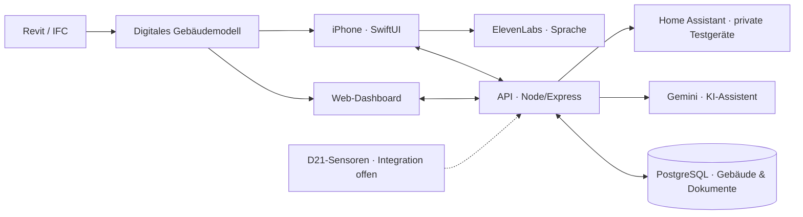

# 🏢 Nala Solutions · KI trifft Gebäude

### Digitaler Gebäudezwilling · BIM · Gebäudeautomation · Künstliche Intelligenz

**GST-Teamprojekt 1 · Hochschule Darmstadt · Gebäude D21**

*Gebäude verstehen, Daten verknüpfen und Technik intelligent bedienen – im Browser und auf dem iPhone.*

[**🌐 Dashboard**](https://nala-solutions.de) · [**✨ Projektseite**](https://kitrifftgebäude.de) · [**📋 Aufgaben**](../../issues) · [**📝 Änderungen**](CHANGELOG.md)

Dashboard: nala-solutions.de · Öffentliche Landingpage: kitrifftgebäude.de · Für das Dashboard ist eine Anmeldung erforderlich.

---

## 💡 Die Idee

Ein Gebäude besteht aus mehr als Plänen: Räume, Anlagen, Dokumente, Messwerte und Zuständigkeiten gehören zusammen. **KI trifft Gebäude** führt diese Informationen in einem digitalen Gebäudepass zusammen und verbindet sie mit einem interaktiven **IFC-/BIM-Modell**.

Am Beispiel des Hochschulgebäudes **D21** entwickeln wir einen Prototyp, der Gebäudeinformationen im Web und auf dem iPhone nutzbar macht. KI unterstützt bei der Suche und Bedienung; ESP32- und Home-Assistant-Anbindungen sind implementiert; ein freigegebener realer D21-Datenpunkt und die reproduzierbare Revit-Anbindung bleiben wichtige nächste Schritte.

## ✨ Funktionen im Überblick

| Bereich | Was der Prototyp bietet |
| :--- | :--- |
| 🏠 **Digitaler Gebäudepass** | Gebäude, Fotos, Dokumente und Pläne zentral verwalten; Zugriff über persönliche Konten und Freigaben |
| 🧊 **BIM & IFC** | 3D-Modelle ansehen, Geschosse und Bauteile auswählen, Ansichten verändern und Modellinformationen abfragen |
| 📱 **Web & iPhone** | React-/Vite-Dashboard und native SwiftUI-App mit gemeinsamer Server-Datenbasis |
| 🌡️ **Sensorik & Energie** | Dashboards, CSV-Import und Auswertungen; reale, simulierte und wetterbasierte Werte werden unterschieden |
| 💡 **Gebäudeautomation** | Erste private Home-Assistant-Lampenanbindung mit Zuordnung zu Gebäuden und IFC-Räumen |
| 🤖 **KI & Sprache** | Gebäudeassistent mit Google Gemini, IFC-Fakten als Kontext und bewusst gestartete Sprachfunktionen mit ElevenLabs |
| 👥 **Zusammenarbeit** | Gebäudefreigaben, Einladungen, gemeinsame Dokumente und Team-Chat |
| 🗺️ **Karten & Heatmaps** | Standortbezogene Ansichten, Kartenumgebung und klar gekennzeichnete Wetter-/Simulationsdaten |
| 📐 **Plan → IFC** | Unterstützte Erzeugung **prüfbarer Entwürfe** aus Plänen; keine automatische fachliche Freigabe |

> **Wichtig:** Dies ist ein Entwicklungsprototyp. Eine private Lampensteuerung ist **keine** Anbindung der D21-Gebäudeautomation. Wetter- und Simulationsdaten sind **keine** echten D21-Sensormesswerte. Ein erfolgreicher Build ersetzt keinen Praxistest.

## 🚀 Projektstand

**Dokumentationsstand: 17. November 2026, Repository-Abgleich (Quellcode; kein Gerätetest).** Für den tagesaktuellen Code- und Freigabestatus gelten die [Pull Requests](../../pulls) und der [Changelog](CHANGELOG.md).

| Thema | Nachgewiesener Stand / Grenze |
| :--- | :--- |
| **iPhone-App** | Aktueller Quellstand **1.0.149**: iPhone-App heißt **Nala**, die Gebäudeassistentin hat einen eigenen Reiter mit überarbeitetem Chat ([#198](../../pull/198), [#200](../../pull/200), [#201](../../pull/201)); zuvor Produktname **Nala Solutions**, zusätzlich Planerkennung aus Fotos/Scans und Korrektur-Editor ([#185](../../pull/185)), gemeinsame Sensor-Raum-Zuordnung ([#187](../../pull/187)), ESP32-/BME280-Raumbezug ([#188](../../pull/188)), Fortschritt und Ebenenwahl beim Planentwurf ([#194](../../pull/194)). Die Version 1.0.149 vereinheitlicht Lampenkarten, verhindert doppelte Home-Assistant-Lampeneinträge und erlaubt die Raumänderung importierter Lampen ([#219](../../pull/219)). Eine Installation dieses Gesamtstands ist nicht nachgewiesen; direkte Installation war zuletzt durch die fehlende Geräteregistrierung im Hochschul-Developer-Team blockiert. |
| **Web & IFC** | **[nala-solutions.de](https://nala-solutions.de)** ist laut Repository-Konfiguration der Dashboard-Zugang mit persönlicher Account-Anmeldung, ohne vorgeschalteten Browser-Passwortdialog ([#193](../../pull/193)). **[kitrifftgebäude.de](https://kitrifftgebäude.de)** bleibt die öffentliche Landingpage. Dashboard-Widgets, gemeinsame Gebäudemappen, IFC-Viewer und Heatmaps sind integriert. Raum-Popups mit Sensorwerten, Raumumbenennung und eine Sensorzuordnung mit Rückfrage sind im Quellcode dokumentiert ([Arbeitsbericht 17.11.](docs/protokolle/2026-11-17-raum-popups-sensoren.md)); automatische Zuordnung ist nicht mit einer fachlich geprüften D21-Sensorintegration gleichzusetzen. |
| **Sensorik** | ESP32-Testübertragung, gemeinsame Raumzuordnung und BME280-/IFC-Raum-Schnittstelle implementiert ([#180](../../pull/180), [#187](../../pull/187), [#188](../../pull/188)). Simulation und echte Messungen bleiben getrennt. Implementierung ersetzt keinen Hardware-Dauertest und keinen Nachweis für echte D21-Werte. |
| **Plan → IFC** | Vektorvermessung, Erkennung von Fotos/Scans, Korrektur-Editor und Ebenenwahl sind gemergt. Vorübergehende Gemini-Überlastung wird wiederholt und als vorübergehend gemeldet ([#190](../../pull/190)); Planrahmen-Erkennung korrigiert ([#191](../../pull/191)). Ergebnisse bleiben prüfpflichtige Entwürfe. |
| **KI** | Lesende Gemini-Werkzeuge für IFC-Räume, Bauteile, Messwerte, Wetter und Geräte sind gemergt ([#161](../../pull/161)); Mengen, Kollisionshinweise, Elementfilter und Modellvergleich wurden ergänzt ([#164](../../pull/164)). Ergebnisse bleiben fachlich zu prüfen |
| **D21-Messdaten** | Erster echter Datenpunkt mit Quelle, Einheit, Zeitstempel und Zugriffsfreigabe noch **nicht als abgeschlossen nachgewiesen** |
| **Revit-Anbindung** | Modell-/IFC-Arbeit vorhanden; reproduzierbarer automatischer Revit→Server-Prozess noch offen |

**Nächster Projekttermin:** 23. November 2026, 14:00 Uhr · Green Office, Gebäude C10.  
**Geplante Abgabe:** 5. Februar 2027.

### 🎯 Aktuelle Prioritäten

1. **P1 · [#74](../../issues/74)** – echten D21-Messwert mit Datenquelle, Einheit, Zeitstempel und Testnachweis integrieren (**Frist 13.11. überschritten; Abschluss gesondert prüfen**).
2. **P1 · [#102](../../issues/102)** – Sensoren, Thermostate, Schnittstellen und Datenrechte abstimmen.
3. **P1 · [#105](../../issues/105)** – Datenschutz und erforderliche Freigaben klären.
4. **P1 · [#101](../../issues/101)** – Hochschul-KI-Infrastruktur und Zugänge prüfen.
5. **P2 · [#73](../../issues/73)** – Revit-/IFC-Übergabe zum Server reproduzierbar dokumentieren.
6. **P2 · Protokollprüfung** – [Entwurf 10.11.](docs/protokolle/README.md) durch tatsächlich Beteiligte prüfen und freigeben; keine Anwesenheiten oder Beschlüsse ergänzen, die nicht belegt sind.
7. **P2 · Review** – [#220](../../pull/220) (Ideenradar Geräte/Gebäude-KI) und [#221](../../pull/221) (Landingpage) sind offen. [#192](../../pull/192), [#197](../../pull/197) und [#202](../../pull/202) wurden gemergt. Den Status weiterer früherer PRs vor einem Merge erneut prüfen. Review und Integration separat durchführen; keine automatische Freigabe fremder Änderungen.

[Alle Issues](../../issues) · [Offene Pull Requests](../../pulls) · [Aufgabenübersicht](docs/aufgabenplan.md)

### 🗒️ Protokolle und Review

**Abgleich 17.11.:** Der Teamtermin vom 10.11. bleibt laut Protokollverzeichnis ein Entwurf ([#196](../../issues/196)). Für weitere mögliche Teamtermine liegen hier keine freigegebenen Sitzungsnachweise vor; fehlende Anwesenheiten oder Beschlüsse werden nicht ergänzt. Der historische [Aufgabenplan](docs/aufgabenplan.md) ist ein Planungsvorschlag und nicht automatisch der aktuelle Erledigt-Status. Projektboard-Status und Hardware-/TestFlight-Abnahme sind gesondert zu verifizieren.

Das [Sitzungsprotokoll vom 03.11.](docs/protokolle/README.md) ist freigegeben. Der Termin vom **10.11.** bleibt **Entwurf** und benötigt Gegenprüfung durch Beteiligte. Technische Arbeitsberichte sind keine freigegebenen Teamprotokolle.

Die vormals offenen PRs **#153, #163, #167, #168, #169, #171 und #173 sind inzwischen zusammengeführt**. Sie werden nicht weiter als ausstehende Reviews geführt. Code-Merge, Geräteinstallation, TestFlight-Veröffentlichung und fachliche Abnahme bleiben getrennte Nachweise.

[Arbeitsabschluss 16.11. · veröffentlichter Stand, Prüfungen und nächste Schritte](docs/protokolle/2026-11-16-technischer-arbeitsabschluss.md)

## 🧩 So funktioniert das System

**Sicherheit und Datenhaltung:** Gebäudezugriffe werden serverseitig geprüft. API-Schlüssel gehören nicht ins Repository. Die ursprünglichen IFC-Dateien bleiben bei Ansichtsänderungen erhalten. KI- und Sprachdienste erhalten nur die jeweils vorgesehenen Daten und Berechtigungen.

[Technische Details](dashboard/README.md) · [iOS-App](ios/README.md) · [IFC-Viewer](docs/web-bim-viewer.md) · [Geräte & Räume](docs/geraete-raeume-rgb-karten.md)

## 👥 Unser Team

| Teammitglied | Schwerpunkt |
| :--- | :--- |
| **Felix** | Projektkoordination, Server, iPhone-App |
| **Emir** | Web-App, Oberfläche und Web-Assistent |
| **Benjamin** | Sensorik, Schnittstellen und Datenintegration |
| **Lukas** | Revit, IFC und Datenschutzthemen |
| **Josef** | Revit-Modellprüfung und KI-Infrastruktur |
| **Vincent** | Landingpage, Dokumentation und Präsentation |

[Ausführliche Verantwortlichkeiten](docs/verantwortlichkeiten.md) · [Zusammenarbeit](CONTRIBUTING.md)

## 📚 Dokumentation

| Thema | Weiterführende Informationen |
| :--- | :--- |
| 📌 **Aktuelle Änderungen** | [CHANGELOG.md](CHANGELOG.md) · [Pull Requests](../../pulls) |
| 🗓️ **Protokolle** | [Sitzungs- und Arbeitsprotokolle](docs/protokolle/README.md) |
| 🧊 **BIM / Revit** | [Revit](revit/README.md) · [IFC im Web](docs/web-bim-viewer.md) · [Modellprüfung](docs/revit-planrekonstruktion.md) |
| 📱 **App / Backend** | [iOS](ios/README.md) · [Dashboard](dashboard/README.md) · [Konten-API](docs/konten-api.md) |
| 🤖 **KI & Sprache** | [Gemini](docs/gemini-gebaeudeassistent.md) · [Live-Sprache](docs/iphone-live-sprachassistent.md) |
| 🧪 **TestFlight** | [Externe Beta – Stand und Grenzen](docs/testflight-externe-beta-100.md) |
| 🔎 **Marktforschung** | [Wettbewerbsvergleich](marktforschung/README.md)  |
| 💡 **Ideenradar** | [Neue Ansätze](docs/ideenradar/README.md) |
| 🗂️ **Projektorganisation** | [Projektsteckbrief](docs/projektsteckbrief.md) · [Aufgabenplan](docs/aufgabenplan.md) |

**Protokollstatus:** 03.11.2026 freigegeben; 10.11.2026 als Entwurf dokumentiert und noch gegenzuprüfen. Technische Arbeitsberichte sind keine freigegebenen Sitzungsprotokolle.

**Private D21-Dateien:** [Projektdateien und Releases](https://github.com/felixdoering05-prog/D21-Projektdateien/releases/latest) – nur für berechtigte Teammitglieder. Keine nicht freigegebenen Pläne im öffentlichen Repository ablegen.

---

**KI trifft Gebäude** · Hochschule Darmstadt · Gebäudesystemtechnik

*Ein Hochschulprojekt – entwickelt, getestet und Schritt für Schritt verbessert.*

[Historische Projektpflege vom 13.–14. November](docs/protokolle/2026-11-14-projektpflege-historisch.md) · [Aktuelle Änderungen](CHANGELOG.md)
