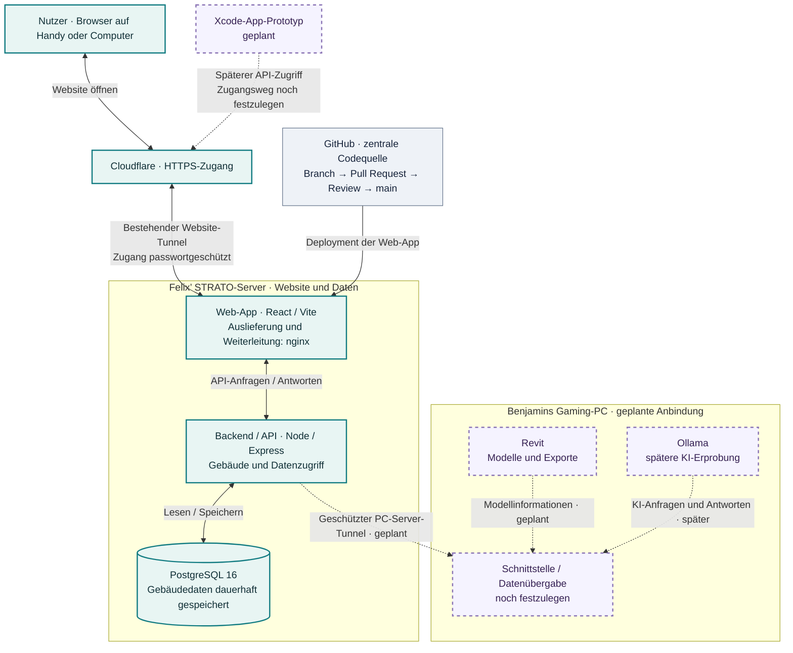

# KI TRIFFT GEBÄUDE
### D21 Digital Twin · GST-Teamprojekt 1 · Hochschule Darmstadt

### [🌐 D21-Dashboard öffnen](https://filling-vendor-verification-hop.trycloudflare.com)

Zugang passwortgeschützt · Vorläufige Testadresse; kann sich beim Neustart des Cloudflare-Tunnels ändern.

**Gebäudedaten zusammenführen. Revit anbinden. KI nachvollziehbar erproben.**

[Aufgaben](../../issues) · [Wochenplan](../../issues/13) · [Protokolle](docs/protokolle/README.md) · [Zusammenarbeit](CONTRIBUTING.md)

## Unser Ziel

Wir entwickeln einen Prototyp für einen digitalen Gebäudepass des **D21**. Eine gemeinsame Weboberfläche soll Gebäudedaten, Pläne und Bilder zugänglich machen und später Informationen aus Revit aufnehmen. Ergänzend untersuchen wir, wie eine lokal betriebene KI bei der Auswertung von Gebäudedaten helfen kann.

Wir arbeiten schrittweise: zuerst eine verlässliche Grundlage mit Datenablage und Schnittstellen, danach Revit-Anbindung und abgegrenzte KI-Versuche. Ergebnisse und Grenzen werden dokumentiert; geplante Funktionen sind keine bereits fertigen Leistungen.

## Aktueller Stand · 27. Oktober 2026

| Bereich | Stand |
| :--- | :--- |
| Website und Server | Eine erste Dashboard-Version ist online und passwortgeschützt erreichbar. |
| Gemeinsamer Code | GitHub ist die einzige Codequelle; die Anwendung liegt unter [`dashboard/`](dashboard/). |
| Gebäudeverwaltung | Persönliche Konten und Gebäude werden in PostgreSQL gespeichert. Web und iPhone verwenden dieselben Konten. |
| Vollständige App-Oberfläche | Emirs umfangreicherer Stand aus den Screenshots muss noch mit dem gemeinsamen Repository abgeglichen werden: [Aufgabe #21](../../issues/21). |
| Bilder, PDFs und DWG | Persönliche Dateiablage pro Gebäude in PostgreSQL, nutzbar im Web und auf dem iPhone. Bild-/PDF-Vorschau; DWG herunterladen bzw. in CAD-App öffnen. [Details](docs/dateien.md) |
| Gaming-PC-Verbindung | Geschützter Tunnel zwischen Benjamins Gaming-PC und dem Server ist noch einzurichten: [Aufgabe #19](../../issues/19). |
| Revit und KI | Revit-Anbindung, Modellimport und Ollama-Anbindung sind noch nicht als funktionierender Gesamtprozess umgesetzt. |

Die Seiten für BIM-Viewer, Sensorik, Energie, Analyse und Meldungen aus den Screenshots gehören zum abzugleichenden App-Stand. Ihr Funktionsumfang und ihre Datenquellen müssen geprüft werden.

## Geplante Bausteine

Das Projekt verbindet eine Weboberfläche mit zentraler Datenablage, einem Revit-Prototyp und späteren KI-Versuchen. Schnittstellen und Datenübergabe werden schrittweise getestet. Die kurzfristige Verbindungsaufgabe umfasst keine Ollama-Anbindung.

## Team und Verantwortlichkeiten

| Wer | Verantwortung | Arbeitspakete |
| :--- | :--- | :--- |
| **Felix** | Projektmanagement und Xcode | Pläne, Zugänge und Budget klären; ersten Xcode-Bildschirm erproben · [#6](../../issues/6), [#8](../../issues/8) |
| **Emir** | App-Entwicklung | Vollständigen App-Code bereitstellen, Oberfläche und Upload-Ablauf abgleichen · [#7](../../issues/7), [#21](../../issues/21) |
| **Benjamin** | Schnittstellen und Verbindung der Systeme | API-Abstimmung, Gaming-PC-Tunnel und Datenübergabe · [#9](../../issues/9), [#19](../../issues/19) |
| **Vincent** | Dokumentation und Projektvorstellung | Projektwebsite und verständliche Dokumentation · [#10](../../issues/10) |
| **Lukas & Josef** | Revit-Prototyp | Kleines Modell und Export prüfen; beide dokumentieren ihren Beitrag · [#11](../../issues/11) |
| **Josef** | Ollama-Erprobung | Abgegrenzte Versuche mit dokumentierten Prompts, Ergebnissen und Grenzen · [#12](../../issues/12) |

Änderungen an API und Datenbank werden mit Benjamin abgestimmt; die App-Entwicklung liegt bei Emir.

## Nächste Schritte und Termine

### Bis Mittwoch, 28. Oktober 2026

- **Benjamin:** Gaming-PC und STRATO-Server über einen geschützten Tunnel verbinden, Erreichbarkeit und Wiederanlauf prüfen sowie Revit-Datenübergabe dokumentieren · [#19](../../issues/19).
- **Emir:** Vollständigen App-Stand als Pull Request bereitstellen, Demo-/Platzhalterfunktionen kennzeichnen und den Upload-Abgleich mit Benjamin dokumentieren · [#21](../../issues/21).

### Bis Dienstag, 3. November 2026

Jede Person arbeitet konkret an ihrem Bereich und bringt ein kleines vorzeigbares Ergebnis oder einen nachvollziehbar dokumentierten Versuch mit. Ergebnisse und Blocker werden in den jeweiligen Aufgaben festgehalten.

- Gebäudedetailansicht und gemeinsamer Dateiablauf: **Gebäude anlegen → öffnen → Bild/PDF hochladen → neu laden → Datei wieder öffnen**.
- Revit-Testmodell und erster geprüfter Export.
- Xcode-Prototyp mit einem ersten Gebäudebildschirm.
- Projektvorstellung und aktualisierte Dokumentation.
- Separater Ollama-Test mit kleinen freigegebenen Beispieldaten.

Der [Wochenplan #13](../../issues/13) bündelt die Arbeitspakete. Für #19 und #21 gilt der frühere Termin am 28. Oktober.

### Externe Klärungen

Felix fragt bei Herrn Bürgy nach den **Bauplänen des D21**, möglichen Revit-/IFC-Modellen, Informationen zu technischen Anlagen und Herstellern sowie Budget für einen KI-Pro-Zugang. Der Zugang zu den Bauplänen hat Priorität; Rückmeldungen sind noch offen.

Zusätzlich offen: Emirs SSH-Zugang, vollständige GitHub-Zuordnung, eine dauerhafte Website-Adresse sowie automatische Datenbanksicherung mit geprüftem Wiederherstellungsweg.

## Unser GitHub-Ablauf

**Aufgabe → eigener Branch → Änderung und Prüfung → Pull Request → Review → Merge nach `main` → Deployment**

- Nie direkt auf `main` pushen und keinen Anwendungscode direkt auf dem Server ändern.
- Bestehende Änderungen anderer Teammitglieder erhalten.
- Eigenen Beitrag, Testergebnis und offene Punkte im Issue bzw. Pull Request dokumentieren.
- Keine Passwörter, Tokens, privaten Schlüssel oder nicht freigegebenen Baupläne veröffentlichen. Das Repository ist öffentlich.
- Revit-Dateien und große Binärdateien gemäß [Zusammenarbeitsregeln](CONTRIBUTING.md) verwalten; Modellstand und Ablage nachvollziehbar vermerken.

## Serverstruktur auf einen Blick

Durchgezogen = vorhanden · Gestrichelt = geplant. [Erklärung und Zuständigkeiten](docs/architektur.md).

## Technischer Aufbau

Die Anwendung unter `dashboard/` besteht aus React/Vite mit nginx, Node/Express und PostgreSQL 16 in Docker Compose. Änderungen werden über GitHub geprüft und anschließend über den abgestimmten Deployment-Ablauf veröffentlicht. Zugangsdaten und interne Betriebsunterlagen gehören nicht in das öffentliche Repository.

## Orientierung im Repository

| Ordner | Inhalt |
| :--- | :--- |
| [`dashboard/`](dashboard/) | Frontend, Backend und Docker-Konfiguration |
| [`docs/`](docs/projektsteckbrief.md) | Projektplanung, Entscheidungen und Nachweise |
| [`revit/`](revit/README.md) | Modellstände und Exporthinweise |
| [`ki/`](ki/README.md) | Prompts und dokumentierte Experimente |
| [`daten/beispiele/`](daten/beispiele/) | Kleine freigegebene Beispieldaten |
| [`ergebnisse/`](ergebnisse/README.md) | Geprüfte Projektergebnisse |
| [`.github/`](.github/) | Vorlagen für Aufgaben und Pull Requests |

## Dokumentation und Nachweise

[Projektsteckbrief](docs/projektsteckbrief.md) · [Aufgabenplan](docs/aufgabenplan.md) · [Verantwortlichkeiten](docs/verantwortlichkeiten.md) · [Projektablauf](docs/projektablauf.md) · [Sitzungsprotokolle](docs/protokolle/README.md) · [Leistungsnachweise](docs/leistungsnachweise.md) · [Abgabecheckliste](docs/abgabecheckliste.md)

Die bestehenden Gesamtmeilensteine bleiben bestehen: [M1 – Umfang und Vorgaben](../../issues/1), [M2 – Revit und Pilot](../../issues/2), [M3 – Auswertung](../../issues/3), [M4 – Abgabe](../../issues/4). Hochschulvorgaben, Forschungsfrage und Bewertungskriterien müssen noch konkretisiert werden.

*KI-Ausgaben gelten erst nach fachlicher Prüfung als Projektergebnis.*

Die iPhone-App führt durch Name, Adresse, Fotos, Pläne und Übersicht. Lokale Entwürfe, wiederholbare Uploads und Dateiaktionen sind in der [Gebäudemappen-Dokumentation](docs/gebaeudemappe-ios.md) beschrieben.
