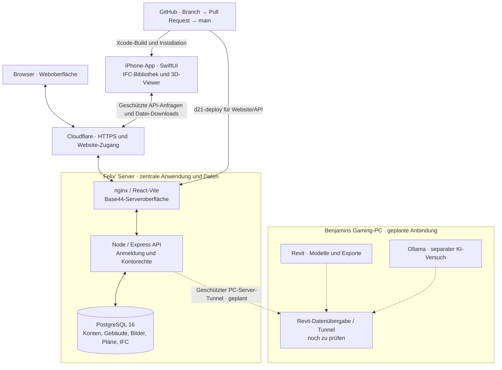

# KI TRIFFT GEBÄUDE
### D21 Digital Twin · GST-Teamprojekt 1 · Hochschule Darmstadt

### [🌐 D21-Dashboard öffnen](https://filling-vendor-verification-hop.trycloudflare.com)

Passwortgeschützter Projektzugang · Vorläufige Cloudflare-Testadresse; sie kann sich bei einem Tunnel-Neustart ändern.

**Gebäudedaten zusammenführen. IFC-Modelle ansehen. Revit anbinden. KI nachvollziehbar erproben.**

[Aufgaben](../../issues) · [Wochenplan](../../issues/13) · [Protokolle](docs/protokolle/README.md) · [Zusammenarbeit](CONTRIBUTING.md)

## Unser Ziel

Wir entwickeln einen digitalen Gebäudepass für das **D21**. Website und iPhone-App nutzen eine gemeinsame Datenablage für persönliche Konten, Gebäude, Bilder, Pläne und IFC-Modelle. Darauf aufbauend erproben wir die Anbindung von Revit und abgegrenzte KI-Anwendungen mit nachvollziehbaren Ergebnissen.

**Stand: 30. Oktober 2026.** Umgesetzte Funktionen, vorbereitete Anbindungen und offene Arbeitspakete werden getrennt ausgewiesen. Ein funktionierender IFC-Viewer ist noch keine automatische Revit-Schnittstelle oder KI-Auswertung.

## Aktueller Entwicklungsstand

| Bereich | Bestätigter Stand |
| :--- | :--- |
| Website | Die aus Base44 übernommene Oberfläche liegt unter [`dashboard/base44-frontend/`](dashboard/base44-frontend/) und nutzt unsere API. Anmeldung, Gebäude und Dateien werden auf dem Projektserver verwaltet. Änderungen im Base44-Editor müssen weiterhin kontrolliert nach GitHub übernommen werden. |
| iPhone-App | Nativer SwiftUI-Prototyp unter [`ios/`](ios/): Projektstart mit Logo, persönliche Anmeldung, Profilbild und Begrüßung mit Account-Namen. |
| Gebäudemappe | Geführte Anlage über Name, Adresse, Fotos, Pläne und Übersicht; lokale Zwischenstände, wiederholbare Uploads, Suche, Vorschau, Umbenennen und Löschen. [Anleitung](docs/gebaeudemappe-ios.md) |
| Gemeinsame Daten | Website und iPhone verwenden dieselben persönlichen Konten, Gebäude und Dateien in PostgreSQL. Andere Konten erhalten keine automatische Gebäudefreigabe. |
| Bilder, PDF und DWG | Upload und Download pro Gebäude, Bild-/PDF-Vorschau; DWG-Dateien können in einer geeigneten CAD-App geöffnet werden. [Dateiablage](docs/dateien.md) |
| IFC-Modelle | Zentrale Ablage pro Gebäude auf dem Server; Upload auch über die Website. In der iPhone-App: 3D-Ansicht mit Drehen, Zoomen, Draufsicht und Bauteilauswahl. Die Modellberechnung läuft auf dem Gerät, nicht auf dem VPS. [IFC-Anleitung](docs/ifc-viewer-ios.md) |
| IFC-Bibliothek | Modellkarten mit Gebäude und Größe, Suche nach Datei-/Gebäudenamen, Ladeanzeigen, gezielte Wiederholungen und verständliche leere Ansichten. Vorhandene Ergebnisse bleiben bei Aktualisierungsfehlern sichtbar. [Stand und Screenshots](docs/protokolle/2026-10-28-ifc-modellbibliothek.md) |
| IFC-Interaktion / Smart Home | Bauteile im iOS-Viewer auswählen, einfärben und ausblenden; simuliertes Raumlicht für `IFCSPACE`-Räume mit Geometrie. **Nur visuelle Simulation**, keine reale KNX-/Lampensteuerung und keine physikalische Lichtberechnung. [Dokumentation](docs/ifc-viewer-ios.md) · [PR #42](../../pull/42) |
| Passwort vergessen | Technisch vorbereitet; echter Mailversand benötigt weiterhin ein eingerichtetes Projekt-Absenderkonto. [Einrichtung](docs/passwort-mail.md) |
| Revit-EG-Arbeitsstand | In Revit 2027.3 wurde lokal ein unvollständiges EG-Modell mit **50 nativen Wänden und 28 geschlossenen Räumen** erstellt; RVT und IFC4 wurden gespeichert und technisch geprüft. **11 Räume** liegen innerhalb des technischen Prüfwerts von 0,03 m², **17** haben noch Flächenabweichungen und **5 Planräume** fehlen. Türen, Fenster, Decken, Dach und weitere Geschosse sind noch offen. Keine fachliche Abnahme und keine Freigabe zum Hochladen. [Arbeitsnachweis](docs/revit-planrekonstruktion.md) · [PR #44](../../pull/44) |
| Gaming-PC / Revit-Datenweg | Der geschützte Tunnel zu Benjamins Gaming-PC und die durchgängige automatische Revit-Übergabe sind weiterhin nicht als funktionsfähig nachgewiesen. Die lokal erzeugten RVT/IFC-Dateien ersetzen keinen PC-Server-Integrationstest. [#9](../../issues/9), [#19](../../issues/19) |
| KI im Produkt | Die Web-Auswertung ist zunächst regelbasiert. Ein echter ChatGPT-/KI-Ablauf und eine Ollama-Anbindung sind noch offen; vorbereitete Oberflächen oder Demo-Daten sind keine produktive KI. [Emirs Aufgabe #33](../../issues/33) |

Die Dateigrenzen betragen **20 MiB je IFC-Datei**, **25 MiB für andere unterstützte Dateien** und **250 MiB pro Konto**. Große echte Revit-Exporte und vollständige Abläufe auf den Geräten des Teams müssen zusätzlich geprüft werden.

Zuletzt umgesetzt: [#39 · IFC-Modellbibliothek](../../pull/39), [#41 · Dokumentation und Claude-Zuordnung](../../pull/41), [#42 · IFC-Bauteilaktionen und Raumlichtsimulation](../../pull/42), [#43 · Revit-API-Vorbereitung](../../pull/43), [#44 · lokaler Revit-EG-Arbeitsstand](../../pull/44). Die frühere Startaufgabe für den Xcode-Prototyp [#8](../../issues/8) ist geschlossen.

## Neue Rückmeldung: Claude-Zugänge und Campus-Heatmap

Herr Bürgy schlägt Claude mit einer Academic-/Team-Einladung vor und benötigt dafür **zwei Einladungs-E-Mail-Adressen**. Abrechnung und Zugangsmodell sind noch zu klären; ein konkreter Budgetbetrag und eingerichtete Zugänge sind nicht bestätigt.

Felix hat folgende Zuordnung festgelegt:

| Geplanter Zugang / Arbeitsbereich | Beteiligte | Schwerpunkt |
| :--- | :--- | :--- |
| **1 · Revit und KI** | **Josef & Lukas** | Revit-Prototyp, Modell-/IFC-Export und nachvollziehbare KI-Versuche |
| **2 · Schnittstellen und App** | **Benjamin & Felix** | PC-Server-Verbindung, Datenübergabe, API-Abstimmung und iOS-Weiterentwicklung |

Das ist die geplante Zuordnung der Arbeitsbereiche, keine Bestätigung bereits angelegter Konten. Felix stimmt die zwei konkreten Einladungsempfänger und E-Mail-Adressen direkt mit Herrn Bürgy ab. Persönliche Einladungsadressen gehören nicht in das öffentliche Repository.

Die Claude-Zugänge dienen zunächst der Projektarbeit. Sie ersetzen weder einen eingerichteten KI-Endpunkt in der App noch den geplanten Ollama-Test.

Zusätzlich nennt Herr Bürgy eine geplante **Campus-Heatmap**, aus der aktuelle und frühere Wärmeverhältnisse erkennbar werden sollen. Eine mögliche Verbindung mit unserem Projekt wird nach seiner angekündigten Abstimmung mit HSE, KNE und BuL geprüft. Datenquelle, Zugang, Schnittstelle und konkreter Projektumfang sind offen. Die **Baupläne des D21 bleiben vorrangig**; ihre Bereitstellung ist noch nicht bestätigt.

[Zuordnung, Status und nächste Schritte](docs/claude-zugaenge-und-campus-heatmap.md) · [Organisation #6](../../issues/6)

## Team und Verantwortlichkeiten

| Wer | Verantwortung | Nächste Arbeitspakete |
| :--- | :--- | :--- |
| **Felix** | Projektmanagement, Server und native iOS-App | Einladungsadressen, Pläne und Budget klären; App weiterentwickeln und auf Geräten prüfen · [#6](../../issues/6) |
| **Emir** | App-/Weboberfläche und Base44-Abgleich | Gemeinsame Datenablage erhalten, ersten echten ChatGPT-Ablauf umsetzen und Einrichtung/KI-Einsatz protokollieren · [#7](../../issues/7), [#21](../../issues/21), [#33](../../issues/33) |
| **Benjamin** | Schnittstellen und Systemverbindung | Gaming-PC-Tunnel, API-/Datenvertrag und Revit-Datenübergabe mit Felix und Emir abstimmen · [#9](../../issues/9), [#19](../../issues/19) |
| **Lukas & Josef** | Revit-Prototyp und KI-Versuche | Kleines Testmodell und geprüften Export erstellen; geplanten Claude-Arbeitsbereich für Revit/KI nutzen, sobald der Zugang eingerichtet ist · [#11](../../issues/11) |
| **Josef** | Ollama-Erprobung | Separaten Versuch auf geeigneter Hardware mit Prompts, Ergebnissen und Grenzen dokumentieren · [#12](../../issues/12) |
| **Vincent** | Dokumentation und Projektvorstellung | Projektwebsite, Gesamtstand und Teamvorstellung pflegen · [#10](../../issues/10), [#40](../../issues/40) |

Die neue Zugangszuordnung ändert diese fachlichen Rollen nicht. API- und Datenbankänderungen mit Felix beziehungsweise Benjamin abstimmen. [Ausführliche Rollenübersicht](docs/verantwortlichkeiten.md)

## Nächste Schritte bis Dienstag, 3. November 2026

- **Felix:** zwei Einladungsempfänger mit Bürgy abstimmen; Bereitstellung und Nutzungsfreigabe der D21-Pläne nachhalten. Abrechnung und Budget bleiben offen, bis sie bestätigt sind.
- **Benjamin & Felix:** Stand der PC-Verbindung dokumentieren, Verbindungsweg testen und Revit-/IFC-Übergabe abstimmen. Der frühere Termin für [#19](../../issues/19) war der 28. Oktober; ein Abschlussnachweis steht noch aus.
- **Lukas & Josef:** den bereits dokumentierten lokalen EG-Modellstand aus [PR #44](../../pull/44) als Ausgangspunkt fachlich gegenprüfen; **17 Raumkonturen korrigieren und 5 fehlende Räume klären**, bevor weitere Geschosse oder Lichtsimulationen freigegeben werden. Eigene Beiträge beider Teammitglieder und die tatsächliche Übergabe separat nachweisen; die bisherigen technischen Prüfungen ersetzen keinen solchen Teamnachweis. [#11](../../issues/11)
- **Emir:** Base44-Serverstand abgleichen, ChatGPT-Anwendungsfall und benötigte Zugänge mit Felix klären, ersten prüfbaren Ablauf und technische Dokumentation liefern · [#33](../../issues/33). Der ältere Export-/Abgleichauftrag [#21](../../issues/21) muss anhand des inzwischen importierten Stands abgeglichen werden.
- **Vincent:** Teamvorstellung und Projektdokumentation aktualisieren; echte und geplante Funktionen unterscheiden.
- **Alle:** mindestens einen nachvollziehbaren Beitrag, Prüfergebnisse und offene Blocker im jeweiligen Issue festhalten.

Der [Wochenplan #13](../../issues/13) bündelt die Arbeit. Zusätzlich offen: dauerhafte Website-Adresse, Projekt-Mailkonto, bestätigter Stand von Emirs SSH-Zugang sowie automatische Datenbanksicherungen mit geprüftem Wiederherstellungsweg. Einzelne Sicherungen vor Deployments ersetzen noch kein automatisches Sicherungskonzept.

## Serverstruktur

Durchgezogen = vorhandener Datenweg · Gestrichelt = noch nicht bestätigte Anbindung. Website und App greifen über die API auf Daten zu, niemals direkt auf PostgreSQL. [Architektur und Grenzen](docs/architektur.md)

## So arbeiten wir auf GitHub

**Aufgabe → eigener Branch → Umsetzung und Prüfung → Pull Request → Review → Merge nach `main`.**

- GitHub ist die einzige Codequelle. Keine direkten Pushes auf `main` und keine Anwendungscode-Änderungen direkt auf dem Server.
- Fremde Änderungen erhalten; eigene Beiträge, Tests und Blocker nachvollziehbar dokumentieren.
- Website/API ausschließlich über `d21-deploy` veröffentlichen. Eine Änderung an der iOS-App wird über Xcode gebaut und installiert; dafür ist kein Server-Neubau nötig.
- Datenbank und bestehende Dateien erhalten. Niemals den Datenbank-Container oder `d21_dbdata` löschen; niemals `docker-compose down -v` verwenden.
- Keine Zugangsdaten, privaten Schlüssel oder nicht freigegebenen Baupläne veröffentlichen. Große Modelle gemäß [CONTRIBUTING.md](CONTRIBUTING.md) verwalten.

## Orientierung und Anleitungen

| Bereich | Einstieg |
| :--- | :--- |
| Website und Backend | [`dashboard/`](dashboard/), [Base44-Serveranbindung](docs/base44-serveranbindung.md) |
| iPhone-App / Xcode | [`ios/README.md`](ios/README.md) |
| Konten und Dateien | [Konten-API](docs/konten-api.md), [Dateiablage](docs/dateien.md), [Gebäudemappe](docs/gebaeudemappe-ios.md) |
| IFC / BIM | [IFC-Viewer, Modellbibliothek und Smart-Home-Simulation](docs/ifc-viewer-ios.md), [Revit-EG-Arbeitsstand](docs/revit-planrekonstruktion.md), [`revit/`](revit/README.md) |
| KI und geplante Claude-Zugänge | [Zugangsplanung und Heatmap](docs/claude-zugaenge-und-campus-heatmap.md), [`ki/`](ki/README.md) |
| Organisation | [Projektsteckbrief](docs/projektsteckbrief.md), [Aufgabenplan](docs/aufgabenplan.md), [Verantwortlichkeiten](docs/verantwortlichkeiten.md) |
| Nachweise | [Protokolle](docs/protokolle/README.md), [Leistungsnachweise](docs/leistungsnachweise.md), [`ergebnisse/`](ergebnisse/README.md) |
| Passwort-Mails | [Einrichtung und aktueller Vorbereitungsstand](docs/passwort-mail.md) |

Die Gesamtmeilensteine bleiben bestehen: [M1 · Umfang und Vorgaben](../../issues/1), [M2 · Revit und Pilot](../../issues/2), [M3 · Auswertung](../../issues/3), [M4 · Abgabe](../../issues/4). Hochschulvorgaben, Forschungsfrage und Bewertungsmaßstäbe müssen weiter konkretisiert werden.

*KI-Ausgaben gelten erst nach fachlicher Prüfung als Projektergebnis.*
