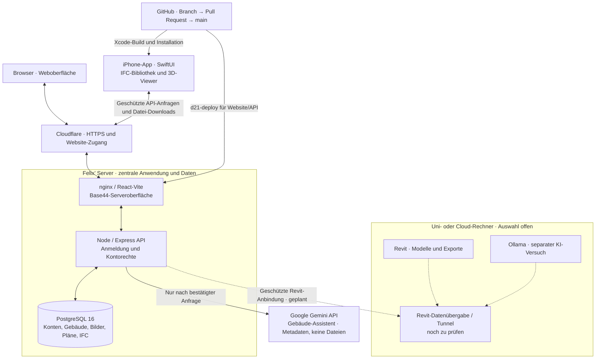

# D21 · Architekturübersicht

Stand: **2. November 2026**. Website und iPhone-App verwenden eine gemeinsame Server-API und PostgreSQL. Die PC-Verbindung ist weiterhin als geplant gekennzeichnet.

## Bestehender Datenweg

- Die aus Base44 übernommene React-/Vite-Oberfläche wird über nginx ausgeliefert. Browser und native SwiftUI-App erreichen die API über den passwortgeschützten HTTPS-/Cloudflare-Zugang.
- Die API verarbeitet persönliche Anmeldung und Eigentümerrechte. PostgreSQL speichert Konten, Gebäude, Profilbilder und Gebäudedokumente einschließlich IFC-Dateien. Clients greifen über die API darauf zu, nicht direkt auf die Datenbank.
- Die iPhone-App bietet geführte Gebäudeanlage, Profilbild, Dateiverwaltung und IFC-Modellbibliothek mit Suche und Fehlerwiederholung. Nach dem geschützten Modell-Download wird die 3D-Geometrie auf dem Gerät berechnet; der VPS speichert und liefert die Datei.
- Website und iOS-App können IFC-Dateien über dieselbe persönliche bzw. freigegebene Gebäudemappe laden und in 3D anzeigen. [IFC-Viewer und Grenzen](ifc-viewer-ios.md)
- Website und API werden nach dem Merge mit `d21-deploy` aktualisiert. Die iOS-App wird separat über Xcode gebaut und installiert.

## Geplante Anbindungen

Benjamins Gaming-PC steht nicht zur Verfügung. Für Revit und gegebenenfalls lokale KI ist ein Uni-Rechner oder Cloud-Rechner vorgesehen; Auswahl und sichere Verbindung sind offen. Für den ersten App-Assistenten wird die Gemini-API genutzt. Ein vollständiger Revit-Datenweg ist weiterhin nicht nachgewiesen. Ein manuell hochgeladenes IFC-Modell belegt noch keine automatische Revit-Schnittstelle.

Der bestehende Website-Tunnel und die geplante Revit-Rechner-Verbindung sind zwei unterschiedliche Verbindungen. Ollama bleibt ein gesonderter Versuch und ist nicht Teil der kurzfristigen Tunnel-Aufgabe. [Tunnel #19](../../../issues/19), [Schnittstellen #9](../../../issues/9), [Revit #11](../../../issues/11), [Ollama #12](../../../issues/12)

## KI-Werkzeuge und Campus-Heatmap

Die zwei geplanten Claude-Arbeitsbereiche sind **Josef/Lukas** für Revit und KI sowie **Benjamin/Felix** für Schnittstellen und App. Einladung und Abrechnung sind noch zu klären. Diese Werkzeuge sind noch kein integrierter KI-Endpunkt in der Anwendung.

Die von Herrn Bürgy erwähnte Campus-Heatmap ist eine mögliche Erweiterung nach weiterer Abstimmung. Datenquelle, Zugriff und Schnittstelle sind offen; deshalb ist sie nicht als bestehender Datenweg eingezeichnet. [Rückmeldung und Zugangsplanung](claude-zugaenge-und-campus-heatmap.md)

## Betrieb und Verantwortlichkeiten

Website, API und Datenbank bleiben auf Felix’ Server; bestehende Daten und das Volume `d21_dbdata` werden erhalten. Benjamin verantwortet die Komponenten-Schnittstellen, Felix die Server-/iOS-Arbeit, Emir den App-/Webabgleich und den Web-KI-Abgleich. Lukas/Josef bearbeiten Revit-/KI-Versuche, Vincent die Gesamt-/Projektdokumentation. [Rollen und Aufgaben](verantwortlichkeiten.md)

Die öffentliche Grafik enthält keine internen Zugangsdaten. Sie unterscheidet den vorhandenen Datenweg (durchgezogen) von der noch nicht bestätigten PC-Anbindung (gestrichelt).

## Gemini-Gebäude-Assistent

Die iPhone-App ruft ausschließlich unsere authentifizierte API auf. Der Server prüft Gebäudezugriff, freigegebenen Datenstand und Nutzungslimits und sendet erst dann die Frage samt Metadaten an Google. Der Schlüssel liegt außerhalb des Git-Repositories und wird nur in den API-Container eingebunden. Kein direkter Google-Schlüssel in der App; keine automatische Übertragung von Dateiinhalten oder Teamchat. [Bedienung und API-Vertrag](gemini-gebaeudeassistent.md).
