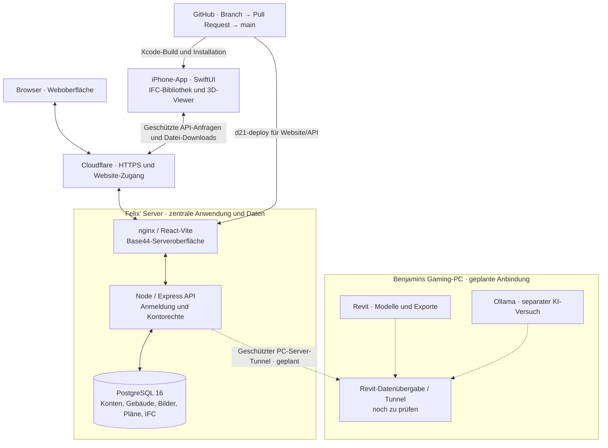

# D21 · Architekturübersicht

Stand: **29. Oktober 2026**. Website und iPhone-App verwenden eine gemeinsame Server-API und PostgreSQL. Die PC-Verbindung ist weiterhin als geplant gekennzeichnet.

## Bestehender Datenweg

- Die aus Base44 übernommene React-/Vite-Oberfläche wird über nginx ausgeliefert. Browser und native SwiftUI-App erreichen die API über den passwortgeschützten HTTPS-/Cloudflare-Zugang.
- Die API verarbeitet persönliche Anmeldung und Eigentümerrechte. PostgreSQL speichert Konten, Gebäude, Profilbilder und Gebäudedokumente einschließlich IFC-Dateien. Clients greifen über die API darauf zu, nicht direkt auf die Datenbank.
- Die iPhone-App bietet geführte Gebäudeanlage, Profilbild, Dateiverwaltung und IFC-Modellbibliothek mit Suche und Fehlerwiederholung. Nach dem geschützten Modell-Download wird die 3D-Geometrie auf dem Gerät berechnet; der VPS speichert und liefert die Datei.
- Auf der Website können IFC-Dateien hoch- und heruntergeladen werden. Die neue 3D-Ansicht ist zunächst in der iOS-App verfügbar. [IFC-Viewer und Grenzen](ifc-viewer-ios.md)
- Website und API werden nach dem Merge mit `d21-deploy` aktualisiert. Die iOS-App wird separat über Xcode gebaut und installiert.

## Geplante Anbindungen

Revit und Ollama sind für Benjamins Gaming-PC vorgesehen. Der geschützte Tunnel und ein vollständiger Revit-Datenweg sind noch nicht als eingerichtet bestätigt. Ein manuell hochgeladenes IFC-Modell belegt noch keine automatische Revit-Schnittstelle.

Der bestehende Website-Tunnel und die geplante Verbindung zum Gaming-PC sind zwei unterschiedliche Verbindungen. Ollama bleibt ein gesonderter Versuch und ist nicht Teil der kurzfristigen Tunnel-Aufgabe. [Tunnel #19](../../../issues/19), [Schnittstellen #9](../../../issues/9), [Revit #11](../../../issues/11), [Ollama #12](../../../issues/12)

## KI-Werkzeuge und Campus-Heatmap

Die zwei geplanten Claude-Arbeitsbereiche sind **Josef/Lukas** für Revit und KI sowie **Benjamin/Felix** für Schnittstellen und App. Einladung und Abrechnung sind noch zu klären. Diese Werkzeuge sind noch kein integrierter KI-Endpunkt in der Anwendung.

Die von Herrn Bürgy erwähnte Campus-Heatmap ist eine mögliche Erweiterung nach weiterer Abstimmung. Datenquelle, Zugriff und Schnittstelle sind offen; deshalb ist sie nicht als bestehender Datenweg eingezeichnet. [Rückmeldung und Zugangsplanung](claude-zugaenge-und-campus-heatmap.md)

## Betrieb und Verantwortlichkeiten

Website, API und Datenbank bleiben auf Felix’ Server; bestehende Daten und das Volume `d21_dbdata` werden erhalten. Benjamin verantwortet die Komponenten-Schnittstellen, Felix die Server-/iOS-Arbeit, Emir den App-/Webabgleich und die geplante ChatGPT-Integration. Lukas/Josef bearbeiten Revit-/KI-Versuche, Vincent die Gesamt-/Projektdokumentation. [Rollen und Aufgaben](verantwortlichkeiten.md)

Die öffentliche Grafik enthält keine internen Zugangsdaten. Sie unterscheidet den vorhandenen Datenweg (durchgezogen) von der noch nicht bestätigten PC-Anbindung (gestrichelt).
