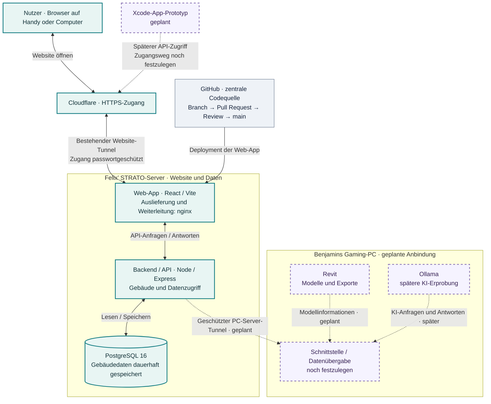

# D21 · Architekturübersicht

Stand: 27. Oktober 2026 · Übersicht des bestätigten Projektstands und der geplanten Erweiterungen.

## So liest sich die Grafik

- **Durchgezogene Verbindungen:** bestehender Website-Zugang, API-/Datenbankzugriff und GitHub-Deployment.
- **Gestrichelte Verbindungen:** geplante Schnittstellen; noch kein bestätigter durchgängiger Betrieb.
- Die Web-App wird vom Server geladen und läuft im Browser. Das Backend verarbeitet Anfragen und greift auf PostgreSQL zu. Der Browser greift nicht direkt auf die Datenbank zu.
- Die Datenbank bleibt auf dem Server. Revit und perspektivisch Ollama sind für Benjamins Gaming-PC vorgesehen; eine direkte Datenbankfreigabe an den PC ist nicht eingeplant.
- Der vorhandene Cloudflare-Tunnel für die Website und der geplante PC-Server-Tunnel sind zwei getrennte Verbindungen.
- Ollama ist eine spätere Erweiterung und nicht Bestandteil der kurzfristigen Tunnel-Aufgabe.
- Bilder/PDFs: Die zuvor erprobte Upload-Erweiterung muss noch mit dem aktuellen GitHub-Stand abgeglichen werden; deshalb zeigt die Datenbank hier nur den bestätigten Gebäudedaten-Stand.

## Zuständigkeiten und nächste Schritte

| Bereich | Verantwortung | Aufgabe |
| :--- | :--- | :--- |
| App-Oberfläche | Emir | Vollständigen Stand übernehmen und Upload abgleichen · [#21](../../../issues/21) |
| Schnittstellen und PC-Server-Tunnel | Benjamin | Verbindung einrichten und testen · [#19](../../../issues/19) |
| Revit-Prototyp | Lukas & Josef | Modell und Datenexport prüfen · [#11](../../../issues/11) |
| KI-Erprobung | Josef | Ollama separat erproben · [#12](../../../issues/12) |
| Organisation / Xcode-Prototyp | Felix | Projektkoordination und erster App-Bildschirm · [#6](../../../issues/6), [#8](../../../issues/8) |
| Dokumentation / Projektvorstellung | Vincent | Projektstand verständlich dokumentieren · [#10](../../../issues/10) |

Die Grafik enthält bewusst keine Server-IP, internen Pfade, Ports oder Zugangsdaten. Sie beschreibt die Projektarchitektur und ist für das öffentliche Repository bestimmt.
