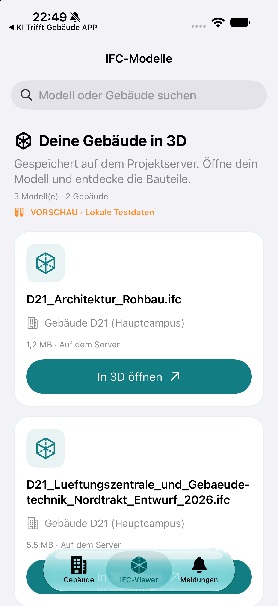
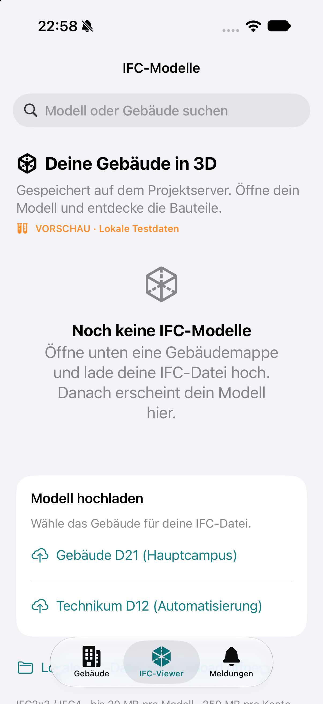

# Arbeitsprotokoll: IFC-Modellbibliothek fertigstellen

Datum: 28. Oktober 2026. Umsetzung: Felix mit Codex. Branch: `feat/ios-ifc-library-complete`.

Ausgangslage: Antigravity hatte auf `feat/ios-ifc-overview` bisher nur uncommittete Mock-Daten für mehrere Gebäude, IFC-Dateien und Fehlerfälle vorbereitet. Diese Vorbereitung wurde übernommen; die bisherige Arbeitskopie wurde nicht verändert.

Ergebnis: native SwiftUI-Modellkarten mit Dateiname, Gebäude und Größe, Suchfeld, getrennte leere Zustände und Suchergebnisse, Ladeanzeige, gezielte Wiederholungen je Gebäude und Modell-Download. Der zuletzt geladene Stand bleibt bei Aktualisierungsfehlern sichtbar. Konto-/Serverwechsel und verspätete Antworten sind abgesichert. Upload-Einstiege und lokale IFC-Vorschau bleiben erreichbar. Keine Backend-, Datenbank- oder API-Vertragsänderungen, kein Server-Deployment nötig.

Der Ladezustand ist in `IFCLibraryState.swift` getrennt von der Darstellung. `ContentView.swift` ergänzt einen werfenden Zugriff auf den vorhandenen Gebäudelisten-Endpunkt und die Debug-Tab-Auswahl; `WorkflowPreview.swift` enthält die übernommenen und ergänzten isolierten Testfälle.

Prüfung: automatisierte Listenprüfungen zu IFC-Filterung, Suche, Teilfehlern, Wiederholung, fehlgeschlagener Aktualisierung, gelöschten Gebäuden, Kontowechsel, verspäteten Antworten und leerer Liste bestanden. Signierte Simulator-Debug- und Release-Builds sowie ein Build des tatsächlich verwendeten OneDrive-Xcode-Projekts bestanden. Im Simulator sind die Suche nach Gebäudename, fehlende Suchergebnisse, lange Dateinamen, die leere Liste mit Upload-Einstiegen das Öffnen einer Karte bis zur sichtbaren 3D-Testwand, der Teilfehler eines Gebäudes mit weiterhin sichtbaren anderen Modellen, ein fehlgeschlagener Download mit erneuter Anfrage sowie das Layout bei maximaler Bedienungshilfen-Schriftgröße geprüft. Die ursprüngliche Simulator-Schriftgröße wurde anschließend wiederhergestellt.

Die Vorschau läuft unter separater App-Kennung und zeigt ausschließlich markierte Testdaten. Echte große Revit-Exporte und VoiceOver auf einem physischen iPhone sind nicht Teil dieser Prüfung. Die Bedienung und reproduzierbaren Testbefehle stehen in [IFC-Viewer für iOS](../ifc-viewer-ios.md).

## Vorschau (ausschließlich lokale Testdaten)

